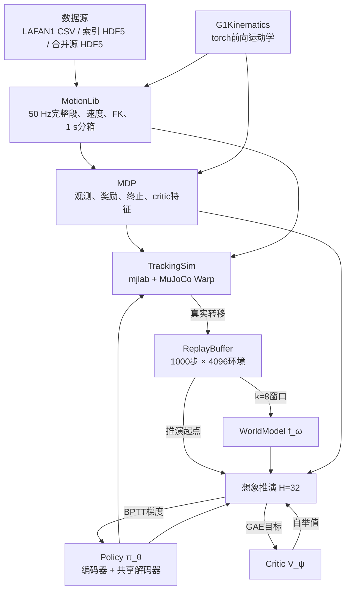
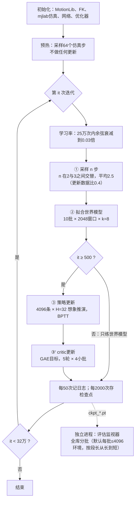
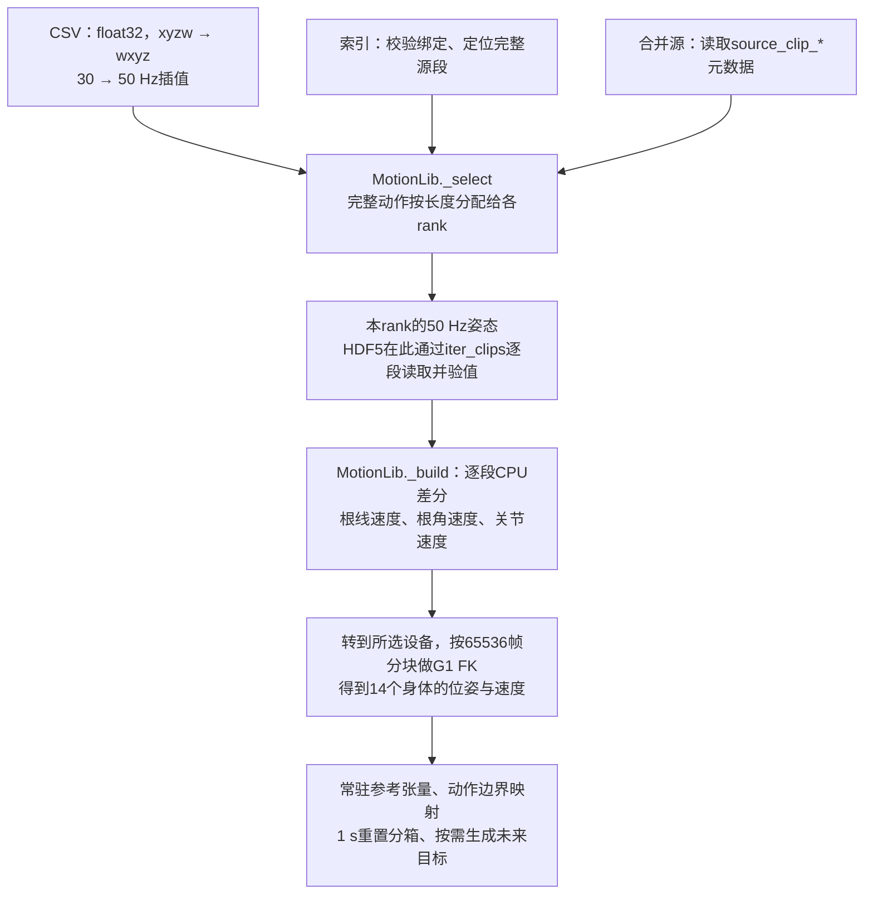
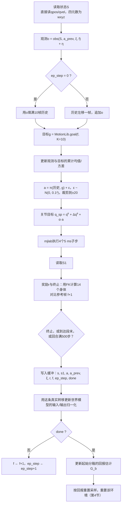
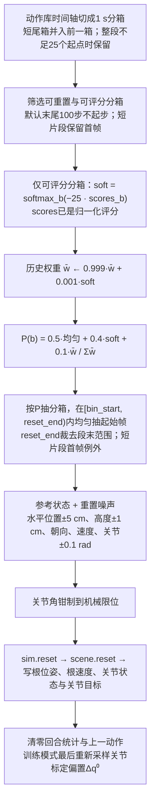
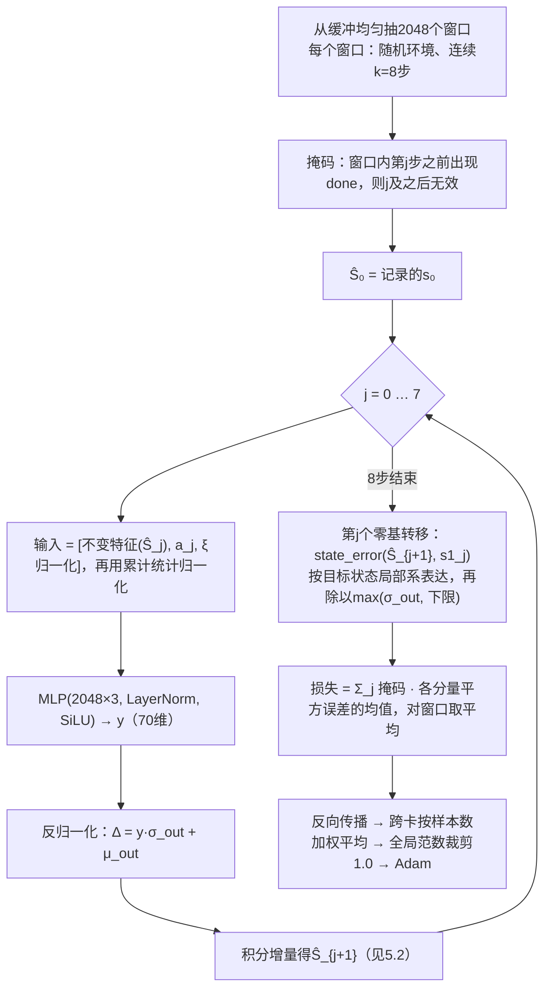
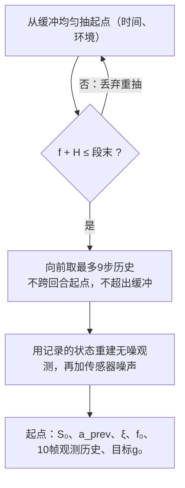
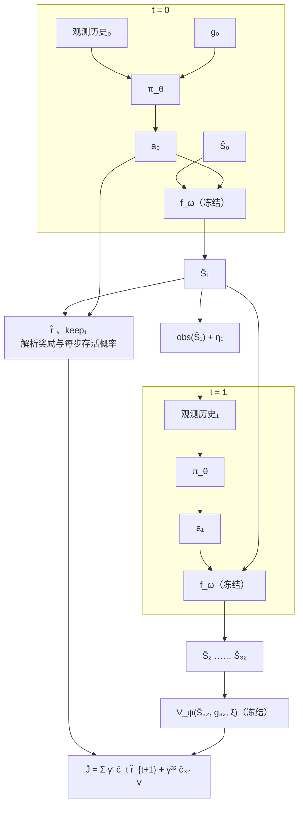
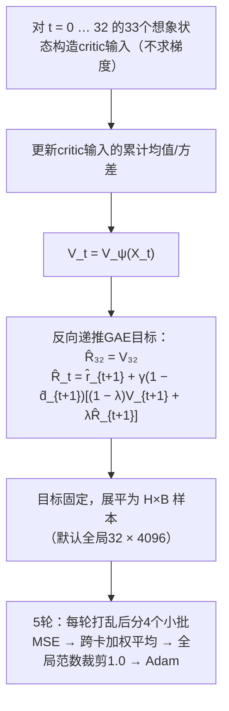
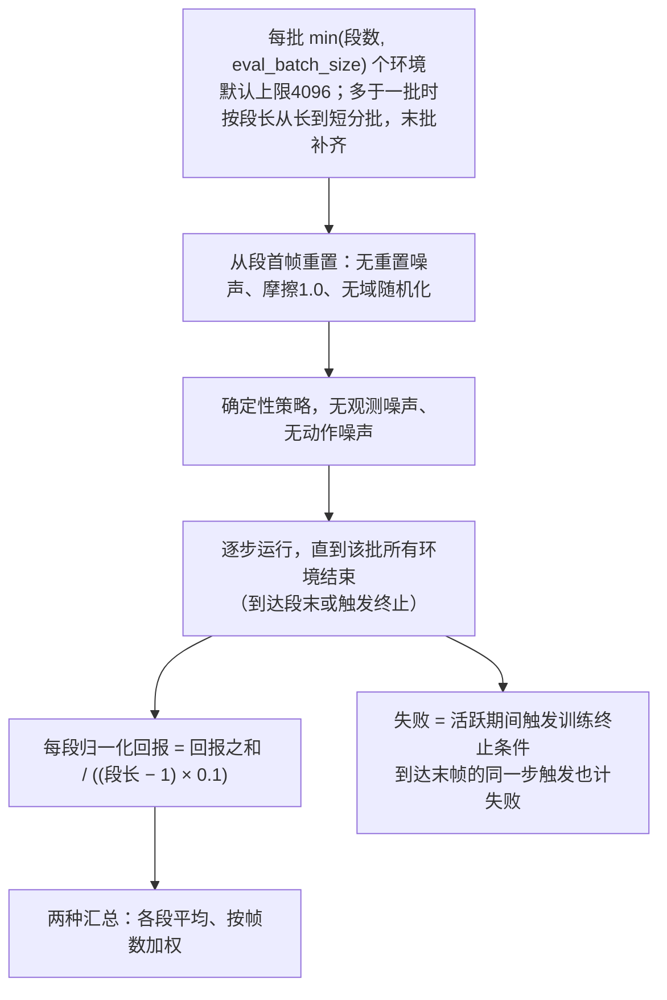

# SuperMimic训练流程与算法细节

- 依据：论文arXiv:2610.28480v1（以“论文”标注节号），以及2026-10-28合并远端`7e9a317`后的实现（含`4293e90`、`e0c923c`；以文件路径标注）。历史测量保留其原始配置，不代表当前默认值的重测结果。
- 与[algorithm.md](algorithm.md)的分工：那份讲论文层面的算法思路与风险；本文按训练流程逐步展开，
  给出流程图、公式、张量维度和实现细节，并在第11节列出实现与论文的差异。
- 公式的逐项拆解、通俗解释与数值算例见[formulas.md](formulas.md)，本文中的公式都标了对应章节。
- 维度与数值均按默认参数：全局4096环境（多卡时按进程拆分）、H=32、k=8、K=10。
- 数据支持LAFAN1 CSV、索引白名单HDF5与合并源HDF5三个入口，训练与评估共用；多卡用torchrun自动分片。

## 1. 全局视图

### 1.1 模块关系



| 模块 | 文件 |
| --- | --- |
| MotionLib | `supermimic/tasks/tracking/motion.py` |
| IndexedG1Dataset / MergedG1Dataset（索引白名单 / 合并源读取） | `supermimic/tasks/tracking/motion_hdf5.py` |
| 分布式上下文、梯度与全局统计同步 | `supermimic/utils/distributed.py` |
| 重置分箱评分与全局重置概率 | `supermimic/tasks/tracking/reset_sampling.py` |
| G1Kinematics | `supermimic/utils/kinematics.py` |
| MDP | `supermimic/tasks/tracking/mdp.py` |
| TrackingSim | `supermimic/tasks/tracking/env.py` |
| ReplayBuffer | `supermimic/tasks/tracking/rl/buffer.py` |
| WorldModel、Policy、Critic | `supermimic/tasks/tracking/rl/networks.py` |
| 训练入口（命令行、进程、数据与运行目录） | `supermimic/scripts/train.py` |
| Trainer（模型、优化器、各更新步骤、日志行与检查点） | `supermimic/tasks/tracking/rl/trainer.py` |
| 训练日志（CSV与TensorBoard） | `supermimic/utils/run_log.py` |

### 1.2 主循环（论文算法A.1）



每次迭代的工作量：

| 阶段 | 每次迭代 | 说明 |
| --- | --- | --- |
| ① 采样 | 4096 × 2.5 ≈ 1.0万条真实转移 | `step_acc += 1/utd`，取整数部分作为本次步数 |
| ② 世界模型 | 10 × 2048 × 8 = 16.4万次单步预测 | 每批独立一次反向传播与Adam更新 |
| ③ 策略 | 4096 × 32 = 13.1万条想象转移 | 一次前向展开、一次反向传播 |
| ③' critic | 13.1万样本 × 5轮，每轮4个小批（每批32,768） | 共20次Adam更新 |

多卡时默认（`--batch_scope global`）上表的批大小是全局总量：`--num_envs`、`--wm_batch`、`--pi_batch` 由各rank按均分规则拆分，
余数分给靠前的rank；`--batch_scope per_gpu`则把它们解释为每卡大小。论文表A.5只有环境数明确标注per GPU，训练批量口径见[双卡短测记录](paper_two_gpu.md)。
每个rank只加载自己的动作分片，各自运行仿真与回放缓冲，更新前跨卡同步梯度。

## 2. 数据与张量约定

### 2.1 数据源与参考张量

训练与评估的命令行共用三个互斥的数据入口：

| 入口 | 参数 | 读取与处理 |
| --- | --- | --- |
| LAFAN1 CSV | `--motion_dir`（默认`data/lafan1_g1`） | 30 fps线性插值加四元数slerp重采样到50 Hz；`--motion_limit` 取排序后的前N个文件 |
| 索引 HDF5 | `--motion_index`，可选`--motion_root` | paired index只当动作身份白名单：按`g1_h5`与`g1_source_clip_index`定位源段，长度和起点取自源库`source_clip_starts/lengths`的完整动作，不读配对窗口，也不读存储裁剪窗 |
| 合并源 HDF5 | `--motion_source` | `MergedG1Dataset`直接读单个原生50 Hz源文件及其`source_clip_*`；不需要索引或`run.json`，动作段须连续覆盖整个帧轴 |

下面重点说明图中CSV与索引HDF5的准入格式。输入须已经重定向到**G1的29个关节**：根是pelvis，
根位置为世界系米制坐标，关节角为rad，根朝向将根系向量旋转到世界系（矩阵左乘列向量），坐标约定与mjlab内置G1一致（Z向上）。
这些是数据生产端的语义约定；加载器的数值校验不能识别单位、坐标轴或关节语义填错。

#### 2.1.1 LAFAN1 CSV：每个文件是一段动作

入口：[`MotionLib.from_dir / __init__`](../../supermimic/tasks/tracking/motion.py)。
读取目录第一层的`*.csv`，按路径排序；`--motion_limit N`取前N个，再按完整动作分配给各rank。
加载使用`np.loadtxt(delimiter=",", ndmin=2)`：数据区为逗号分隔的数值，通常无表头；默认`#`注释可跳过，普通文本表头和字符串时间戳不可直接读入。

| 列（从0起） | 形状 | 内容 |
| --- | --- | --- |
| `0:3` | `(T, 3)` | 根位置`x, y, z`，世界系，m |
| `3:7` | `(T, 4)` | 根朝向四元数`x, y, z, w`（**xyzw**） |
| `7:36` | `(T, 29)` | G1关节角，rad，顺序见下 |
| `36:` | 可选 | 数值列可存在，但不参与参考张量构建 |

必须至少2帧、至少36列；参与读取的根位置、四元数、关节角须全部有限，
每帧四元数满足`abs(norm(q) - 1) <= 1e-4`。校验函数为`validate_pose_arrays`，不合格直接报错。
29个关节严格按[`G1_JOINT_NAMES`](../../supermimic/tasks/tracking/constants.py)排列；CSV没有关节名元数据，加载器按列解释：

```text
 0– 5: left_hip_pitch_joint, left_hip_roll_joint, left_hip_yaw_joint,
       left_knee_joint, left_ankle_pitch_joint, left_ankle_roll_joint
 6–11: right_hip_pitch_joint, right_hip_roll_joint, right_hip_yaw_joint,
       right_knee_joint, right_ankle_pitch_joint, right_ankle_roll_joint
12–14: waist_yaw_joint, waist_roll_joint, waist_pitch_joint
15–21: left_shoulder_pitch_joint, left_shoulder_roll_joint, left_shoulder_yaw_joint,
       left_elbow_joint, left_wrist_roll_joint, left_wrist_pitch_joint, left_wrist_yaw_joint
22–28: right_shoulder_pitch_joint, right_shoulder_roll_joint, right_shoulder_yaw_joint,
       right_elbow_joint, right_wrist_roll_joint, right_wrist_pitch_joint, right_wrist_yaw_joint
```

CSV路径先转成CPU `float32`，把`xyzw`重排为内部`wxyz`，再逐段重采样。
命令行入口固定按30 fps解释；Python构造函数可传`src_fps`，没有从文件读取帧率或时间戳的逻辑。
若源段长`T`，输出帧数为`floor(((T - 1) / src_fps) / 0.02) + 1`；
位置与关节角做线性插值，根朝向做最短弧四元数slerp，输出网格间隔0.02 s，不向源末帧之后外推。
例如4帧30 fps动作覆盖0.1 s，重采样为6帧50 Hz动作。
此处假定输入已完成G1重定向、单位和坐标转换；加载过程不做关节重映射、角度unwrap、关节限位裁剪或接触/穿地修复。

#### 2.1.2 索引 HDF5：索引、运行记录与源分片共同构成入口

入口：[`IndexedG1Dataset`](../../supermimic/tasks/tracking/motion_hdf5.py)，由`MotionLib.from_index`调用。
索引只提供身份；真正的逐帧姿态保存在源分片中。所需文件关系为：

```text
paired_50hz/
  index.h5                    # --motion_index，文件名可自定
  run.json                    # 必须与索引同目录，文件名固定
G1_SOURCE_ROOT/                # run.json.g1_root，或 --motion_root 覆盖
  manifest.json
  shard_000.h5                # run.json绑定、索引g1_h5引用的相对路径
  ...
```

**索引`index.h5`的必需字段**（`C`为白名单动作数，须大于0）：

| 位置 | 类型 / 形状 | 准入要求 |
| --- | --- | --- |
| attribute `format` | 字符串 | `mjbones_human23_g1_nominal_hdf5_v1_index` |
| attribute `complete` | 真值，通常bool | 必须为真 |
| attribute `fps` | 数值 | 必须等于50 |
| `clips/source_relative_path` | HDF5字符串数组`(C,)` | 动作名称/身份，每行唯一；只作名称，不打开对应BVH文件 |
| `clips/g1_h5` | HDF5字符串数组`(C,)` | 源根内的规范相对POSIX路径；拒绝绝对路径、`..`、反斜杠、冒号及解析后逃出源根的路径 |
| `clips/g1_source_clip_index` | 整数数组`(C,)` | 从0起的源动作序号；`(g1_h5, index)`组合必须唯一且序号有效 |
| `clips/g1_source_start`、`clips/g1_source_frames` | 可选整数数组`(C,)` | 若存在，必须与源动作的起点、长度完全一致 |

索引的`clips/start`、`clips/length`和源库的`clip_starts/clip_lengths`不参与动作定位。
`training_ready`也不是此G1加载器的门禁；例如`training_ready=false`仍可加载，不能由此推断human/G1配对已通过时间对齐验证。

**同目录`run.json`的字段要求**：

| 字段 | 内容 |
| --- | --- |
| `format` | `mjbones_human23_g1_nominal_hdf5_v1`（索引格式去掉`_index`） |
| `g1_joint_names` | 与上面的`G1_JOINT_NAMES`列表逐项、按序完全相等 |
| `g1_root` | 未传`--motion_root`时必需，指定默认源根目录；传参时使用覆盖后的目录 |
| `g1_manifest_sha256` | 源根`manifest.json`的SHA256 |
| `g1_snapshot.shards[相对分片路径]` | 含`bytes`、`mtime_ns`、`sha256`；须覆盖索引引用的每个分片 |

**源分片HDF5的必需字段**（`F`为该分片总帧数，`S`为源动作数）：

| 位置 | 类型 / 形状 | 内容或要求 |
| --- | --- | --- |
| attributes `format`、`version` | 字符串、数值 | `teleopit_motion_hdf5`、`1` |
| `root_pos` | **float32** `(F, 3)` | 世界系根位置，m |
| `root_quat_w` | **float32** `(F, 4)` | 世界系根朝向，**wxyz**，与CSV的顺序不同 |
| `joint_pos` | **float32** `(F, 29)` | G1关节角，rad，按绑定的关节顺序 |
| `source_clip_starts` | 整数数组`(S,)` | 每个原始动作在分片帧轴上的起始行 |
| `source_clip_lengths` | 整数数组`(S,)` | 每个原始动作的完整帧数 |
| `source_clip_fps` | 整数数组`(S,)` | 所选动作必须为50；此路径不靠分片顶层`fps`属性判断帧率 |

对于索引中每个身份`(shard, i)`，取`start = source_clip_starts[i]`、`L = source_clip_lengths[i]`，
读取三个姿态数组的`[start:start + L]`。必须`start >= 0`、`L >= 2`、`start + L <= F`；
逐段读帧时再校验NaN/Inf与单位四元数，容差同CSV。原生50 Hz姿态直接进入共同处理流程，不重采样。
`--motion_limit N`保留**索引行顺序**的前N段；构造目录时仍检查整个白名单的身份、元数据和源绑定，逐帧数值检查只覆盖实际读取的动作。

索引与manifest每次计算SHA256；分片默认先比较字节数与纳秒修改时间，二者都相同则使用`run.json`记录的SHA256，
变化时才重算并比对。读帧前后也检查文件状态，发现中途变化即报错。
完整预检可在CPU上执行；下列`--verify_hashes`、`--verify_frames`是**`scripts/check_data.py`的参数**，训练/评估入口没有这两个开关：

```bash
uv run --frozen python scripts/check_data.py \
  --motion_index /path/to/paired_50hz/index.h5 \
  --motion_root /path/to/G1_SOURCE_ROOT \
  --verify_hashes --verify_frames
```

#### 2.1.3 合并源 HDF5：不依赖索引的单文件入口

入口：[`MergedG1Dataset`](../../supermimic/tasks/tracking/motion_hdf5.py)，由`MotionLib.from_source`调用。
顶层属性须为`format=teleopit_motion_hdf5`、`version=1`、`fps=50`；
三个姿态数组的名称、float32类型、形状与四元数顺序和上面的源分片相同。
`source_clip_starts/lengths/fps`描述完整动作：每段至少2帧且50 Hz，第一段从0开始，相邻段无缝衔接，最后一段覆盖到帧轴末尾。
可选`clips/source_relative_path`提供每段名称（行数须等于段数），缺省名称为`clip_000000`等。
此入口不读取`run.json`、manifest或关节名绑定，生产端须确保29维关节语义与顺序正确。

`--motion_limit`保留源元数据顺序的前N段；构造时仍验证全库段边界与帧率，数值校验在实际读帧时进行。
加载期间比较读帧前后的大小和修改时间；指纹只摘要文件大小、总帧数、所选段的起点与长度，
不摘要姿态内容、段名或文件路径。同大小且边界不变的姿态修改可能无法被检查点指纹识别。
`scripts/check_data.py`只支持索引入口，不能用于`--motion_source`。

#### 2.1.4 代码内共同处理：姿态 → 速度 → FK → 参考张量



图中HDF5的目录校验在分片前完成，`iter_clips`的实际姿态读取和数值校验在分片后、`_build`消费迭代器时发生。
CSV则先在每个进程读取并重采样全局所选文件，再只构建本rank的参考张量。

| 阶段 | 当前实现 |
| --- | --- |
| 选择与分片 | `partition_clips`按动作长度从长到短，将完整动作放入累计帧数最少的rank；各rank至少有一段，段内不切分 |
| 线性差分 | `_gradient`以`dt = 0.02`求根线速度、关节速度；内部帧为`(x[t+1] - x[t-1]) / (2dt)`，首尾为单边差分 |
| 旋转差分 | 根世界系角速度内部帧为`so3_log(R[t+1] @ R[t-1].T) / (2dt)`，首尾对应单边差分；所有差分均在原动作内部 |
| FK | `G1Kinematics.forward(p, R, v, w, q, qd)`使用mjlab内置G1，输出14个跟踪身体的世界系位置、朝向、线速度和角速度 |
| 参考表示 | float32存根`p/quat/v/w`、29维`q/qd`、14个身体`p/quat/v/w`、根局部速度`R.T @ v/w`；另存动作与分箱映射 |
| 目标生成 | `future_frames`取`f+1…f+K`并钳制到本段末帧；`goal`按当前参考根的水平朝向表达未来位置/朝向，再拼局部速度、`q`、`0.1 × qd`，默认`K=10`得730维 |

不足33帧的动作仍保留，可参与仿真跟踪与评估；默认32步想象起点须满足`f + 32 <= clip_end`。
训练启动时每个rank至少要有一段长度大于32的动作，实际从回放抽样时再筛选合法起点。
参考加载生成的是物理量与边界信息；网络输入的累计均值/方差归一化在训练阶段另行更新。

#### 2.1.5 分箱、数据指纹与驻留内存

- 时间轴按1 s分箱：每段的 $`L-1`$ 个起点每50个一箱；多分箱片段的最后一箱若不足25个起点，并入前一箱（`motion.bin_counts`），
  除整段不足25个起点的短动作外，每箱保持25–74个起点，`bin_end`记录各箱起点的排他上界，末帧仅作目标。
  全局分箱数按全局所选动作统计（设置`--motion_limit`时为该子集），多卡时每卡只持有本地分箱。
- 生成`reference.json`并写入检查点：索引路径的指纹由索引SHA256、源分片SHA256、长度策略与所选段清单决定，
  CSV路径的指纹由文件名、文件SHA256与源帧率决定；恢复训练或评估时已有指纹不一致直接报错，显式`--motion_limit`子集有独立指纹。
  合并源路径的指纹使用文件大小、帧数与所选段起点/长度等结构元数据，未对姿态内容计算SHA256，绑定强度与索引入口不同。
  `check_reference(current, saved)`仅在`saved`非空时比较；旧检查点缺失或空的`reference`会跳过该次检查。
  run目录里已有的`reference.json`或`eval_reference.json`仍分别校验，不能将旧检查点加载成功解释为它已绑定当前数据。
- 参考张量常驻所选设备。根与14个身体的朝向存为四元数（`RotationView`），按帧索引时才转成旋转矩阵，
  调用方仍写`motion.root_R[f]`、`motion.body_R[f]`。每帧`4×(77+13×跟踪刚体数)+16` = 1,052字节，
  比存3×3矩阵（1,356字节）少22%：本索引全量约38.85 GiB，论文全量BONES-SEED约46.66 GiB。
  加载前按1.1倍加2 GiB余量检查显存，不足时报错，不自动缩减数据。
  代价是每次取用多一次四元数转矩阵；在RTX 4070 Ti SUPER、无`torch.compile`时，策略与critic阶段约慢4%。

### 2.2 状态、上下文与观测

| 量 | 维度 | 组成 |
| --- | --- | --- |
| 状态S | 71（扁平存储） | 根位置p 3、根朝向四元数4（运行时转为旋转矩阵R）、根线速度v 3、根角速度w 3（均为世界系）、关节角q 29、关节速度q̇ 29 |
| 仿真上下文ξ | 33 | 摩擦1、关节标定偏置29、躯干质心偏置3；`normalize_xi`依次为`(μ−0.75)/0.45`、`Δq⁰/0.01`、`ΔCoM/0.05`（质心x采样范围只有±0.025 m，归一化后为±0.5） |
| 观测o | 99 | 论文的93维（q − q⁰ − Δq⁰ 29、q̇ 29、根系角速度3、投影重力3、上一动作29），另加参考根相对机器人根的朝向（6D）6维 |
| 观测历史 | 10 × 99 | 最新一帧在最后；回合第一步用当前帧填满10帧 |
| 目标g | 730 = 10 × 73 | 未来10帧，每帧：相对当前参考根的位置3、朝向6D 6、根系线速度3、根系角速度3、q 29、0.1 × q̇ 29 |

传感器噪声（论文表A.1，均匀分布半宽）：q 0.01 rad，q̇ 0.5 rad/s，角速度0.2 rad/s，投影重力0.05，上一动作无噪声，
实现额外给参考相对朝向加0.05。

### 2.3 网络输入输出

| 网络 | 输入 | 输出 | 结构 |
| --- | --- | --- | --- |
| 世界模型f_ω | 133 = 不变特征71 + 动作29 + ξ归一化33 | 70维局部增量 | MLP(2048, 2048, 2048)，LayerNorm + SiLU，末层零初始化 |
| 运动编码器 | 目标730 | z ∈ (−1, 1)³²（tanh） | MLP(2048, 1024, 512, 256)，ELU |
| 共享解码器 | z 32 + 观测历史990 | 动作29 | MLP(2048, 1024, 512, 256)，ELU，末层权重×0.01 |
| Critic V_ψ | 914 = 不变特征71 + 关节误差29 + 14个身体位置误差42 + 根位置误差3 + 参考相对朝向6 + ξ归一化33 + 目标730 | 标量 | MLP(256, 128)，ELU |

不变特征（`invariant_features`，71维）：根高度1、去掉偏航后的根朝向6D 6、根系线速度3、根系角速度3、q 29、q̇ 29。
它与机器人的水平位置和朝向无关，所以世界模型对平移和转向天然等变。

### 2.4 回放缓冲

按 (时间, 环境) 二维布局，环形覆盖最旧的一行。每条记录：

| 字段 | 维度 | 用途 |
| --- | --- | --- |
| s、s1 | 71、71 | 转移前后状态；s1单独存，这样跨回合的窗口也能拿到正确的目标 |
| a、a_prev | 29、29 | 实际执行的加噪动作、上一动作 |
| ξ | 33 | 该转移所在回合的上下文 |
| r | 1 | 仿真奖励（训练时只用于统计） |
| f | 1（int64） | 参考帧索引 |
| ep_step | 1（int32） | 回合内步数，用于重建观测历史 |
| done | 1（bool） | 终止或超时，用于窗口掩码 |

每条约949字节；全局4096环境的缓冲约3.9 GB，多卡时每卡各存一份、按每卡环境数缩放。

## 3. ① 采样：一个控制步



要点：

**动作映射**（论文附录A）： $`q^{\mathrm{sp}} = \alpha a + q^0`$ ，其中 $`\alpha = 0.25\, \tau_{\max} / K_p`$ （力矩上限除以刚度），取自mjlab内置G1配置。
  实现把关节标定偏置 $`\Delta q^0`$ 同时加在目标和观测上，即 $`q^{\mathrm{sp}} = q^0 + \Delta q^0 + \alpha a`$ ，
  观测为 $`q - q^0 - \Delta q^0`$ ：机器人以为自己在 $`q - \Delta q^0`$ ，这正是“标定误差”的含义。

**奖励**（论文表A.2，`MDP.reward`）：

```math
r_{t+1} = \Delta t \left( r^{\mathrm{track}} + r^{\mathrm{reg}} \right), \quad \Delta t = 0.02
```

```math
\begin{aligned}
r^{\mathrm{track}}
&= e^{-\bar{e}_{\mathrm{pos}}/0.3^2}
   + e^{-\bar{e}_{\mathrm{ori}}/0.4^2} \\
&\quad + e^{-\bar{e}_{\mathrm{lv}}/1.0^2}
   + e^{-\bar{e}_{\mathrm{av}}/3.14^2} \\
&\quad + 0.5\,e^{-e_{\mathrm{rp}}/0.3^2}
   + 0.5\,e^{-e_{\mathrm{ro}}/0.4^2}.
\end{aligned}
```

```math
\begin{aligned}
r^{\mathrm{reg}}
&= -0.1\lVert a_t-a_{t-1}\rVert^2 \\
&\quad -2\sum_j\bigl[
  \max(0,q_j-q_j^{\max}) \\
&\qquad\qquad +\max(0,q_j^{\min}-q_j)\bigr].
\end{aligned}
```

  $`\bar{e}`$ 为14个跟踪身体的平均平方误差（位置、朝向测地角、线速度、角速度）， $`e_{\mathrm{rp}}`$ 、 $`e_{\mathrm{ro}}`$ 为根的位置与朝向误差；
  $`q_j^{\max}`$ 、 $`q_j^{\min}`$ 是按0.9系数收缩后的软限位。追踪项满分5，所以单步最大奖励为 $`5 \Delta t = 0.1`$ 。
  通俗地说：六项打分衡量“像不像”，两项惩罚防止“乱来”，乘 $`\Delta t`$ 让每秒能拿的分与控制频率无关；指数核的直觉、“重新锚定”的推导和完整算例见[formulas.md](formulas.md)第2节。
  身体位置与朝向误差先把参考身体“重新锚定”到机器人根的水平位置和偏航（BeyondMimic做法），
  所以只惩罚姿态和相对位置，不惩罚整体平移漂移；全局漂移由根位置项惩罚。

**终止**（论文附录A）： $`e_z = \lvert z_{\mathrm{ref}} - z \rvert > 0.25\ \mathrm{m}`$ ，或 $`e_{\mathrm{tilt}} = \lvert (R_{\mathrm{ref}})_{33} - R_{33} \rvert > 0.8`$ 。
  后者正是“参考与机器人根系中重力方向z分量之差”，直立参考下约78°（推导见[formulas.md](formulas.md)第3.1节）。

**超时**：到达段末或回合满500步（10 s）。超时不是失败。

**分箱回报估计**（`episode_bin_scores`）：训练入口和`TrackingSim`默认`--bin_skip_steps S=50`，并显式传给评分函数；
评分函数单独调用的`skip_steps`默认仍为0。不计前50个转移时，首个计分奖励是零基步号50对应的 $`r_{51}`$ 。
设回合共 $`T`$ 步且 $`T>S`$ ，保留的长度与折扣回报为：

```math
\begin{aligned}
T' &= T-S,\qquad
\bar r' = \frac{1}{T'}\sum_{t=S}^{T-1}r_{t+1}, \\
G' &= \sum_{t=S}^{T-1}\gamma^{t-S}r_{t+1}
   +\mathbb{1}_{\neg\mathrm{term}}\frac{\gamma^{T'}\bar r'}{1-\gamma}, \\
u &= G'/G_{\max},\qquad G_{\max}=0.1/(1-\gamma), \\
\mathrm{bin\_G}_b &\leftarrow 0.8\,\mathrm{bin\_G}_b+0.2\,u.
\end{aligned}
```

若在前S步内硬终止，评分为0；若在前S步内仅因超时结束，不更新分箱。
同一步有多个有效回合在同一分箱结束时，先对归一化评分取均值，再更新一次EMA，`BinSampler.visits`增加有效回合数。
默认`--bin_prior zero`从0混合；`mean`模式的首次更新直接取观测均值，未访问且可评分分箱的采样评分取已访问可评分分箱的全局均值。

`--bin_clip_end terminal`让到达段末的回合不外推；只因500步上限截断时仍外推。
设 $`n'=\mathrm{clip\_end}-\mathrm{start\_f}-S`$ ，当 $`n'<500-S`$ 时分母为
$`G_{\max}(1-\gamma^{\max(n',1)})`$ ，否则为 $`G_{\max}`$ 。
`S=0`还原尾箱合并后的旧评分；历史首步惩罚与四轮修正分别见[reset_sampling.md](reset_sampling.md)和[reset_curriculum.md](../troubleshooting/reset_curriculum.md)。
上述跳步只影响课程评分，训练奖励、回放和日志`ep_ret_norm`仍包含全部T步。

**多卡采样**：每卡只跑本地环境，`sim_steps`按全局环境数累计；回合结束统计在记日志时跨卡汇总，并按结束回合数加权。


## 4. 按回报重置采样（论文附录D.1）



设 $`A`$ 是可重置分箱集合， $`C\subseteq A`$ 是可评分分箱集合。记分箱起点为 $`b_s`$ 、所属段首末帧为 $`c_s,c_e`$ ，
当前掩码及帧范围为：

```math
\begin{aligned}
A &= \{b:b_s<c_e-M\ \lor\ b_s=c_s\}, \\
C &= \{b\in A:b_s<c_e-M\ \land\ c_e-b_s>S\}, \\
\mathrm{reset\_end}_b
&=\max\bigl(\min(\mathrm{bin\_end}_b,c_e-M),b_s+1\bigr),
\end{aligned}
```

其中 $`M=100`$ 为`--reset_margin`， $`S=50`$ 为`--bin_skip_steps`；起始帧在 $`[b_s,\mathrm{reset\_end}_b)`$ 内均匀抽取。
因此普通起点离段末严格超过100步；整段最多100步时仍保留首帧，但不进入自适应份额。
`BinSampler.scored`控制评分是否用于自适应采样；这些短片段仍可能记录有效回合评分与访问次数。

存在可评分分箱时，抽样权重为：

```math
\begin{aligned}
q_b &= \mathbb{1}_{b\in C}\,
\frac{\exp(-25\,\mathrm{bin\_G}_b)}{\sum_{b'\in C}\exp(-25\,\mathrm{bin\_G}_{b'})}, \\
\bar w_b &\leftarrow 0.999\bar w_b+0.001q_b, \\
P(b) &= \mathbb{1}_{b\in A}\left[\frac{0.5}{|A|}
  +0.4q_b+0.1\frac{\mathbb{1}_{b\in C}\bar w_b}{\sum_{b'\in C}\bar w_{b'}}\right].
\end{aligned}
```

所有集合、softmax分母和历史权重归一化均按全局分箱计算。可重置但不可评分分箱只取均匀份额，禁止重置分箱权重为0。
以上混合公式用于全局至少有一个可评分分箱的情形；集合为空时采用本节末尾的均匀回退。
系数−25有多“尖”、三种成分各起什么作用，见[formulas.md](formulas.md)第8.3–8.4节的算例。

- 可评分分箱的`BinSampler.scores`越低（越难），softmax权重越大；系数−25让分布很尖锐，难点会被集中练习。
- 10%的历史权重让学会之后的难点仍保留一定练习量，防止遗忘。
- 多卡时softmax的max与分母、历史权重的归一化分母都按全局归约计算，但每卡只在本地分片的分箱上按条件分布抽样；
  这样各卡同步更新，却不保证与单卡全库自适应采样、回放轨迹或随机序列逐步等价。
- 重置顺序很关键：mjlab的`scene.reset`会把关节目标清零，所以必须先reset，再写入新状态和目标。
- 尖锐也意味着脆弱：任何让 $`G_b`$ 系统性偏低的偏差都会被放大成课程的集中点（尾部短分箱即一例）。
  训练目录的`sampling_log.csv`每次记日志写入全局权重的熵（除以`log(max(全局分箱数, 2))`）、最大分箱权重、已访问分箱比例、
  距段末2 s内的重置比例，用于发现这类偏差；单独成文件，`train_log.csv`的列不变。
  访问率分子是`BinSampler.visits > 0`的分箱数（至少有一个有效结束回合），分母仍为全部分箱，因此不一定达到100%。

对持有集合 $`A_r`$ 的rank，实际抽样条件概率为 $`P(b\mid r)=P(b)/\sum_{b'\in A_r}P(b')`$ 。
`samp_top1`统计的是全局权重 $`\max_bP(b)`$ ，整体实际重置频率还取决于各rank完成回合和重置的次数。
`reset_tail_frac`使用实际抽样计数，和权重快照的统计口径不同。

**全库没有可评分分箱时的回退（`e0c923c`已修复）。** 例如全库都不超过101帧（最多100个转移），
默认`reset_margin=100`会使所有分箱均不可评分。此时全局指数和`norm`为0，返回
$`P(b)=\mathbb{1}_{b\in A}/|A|`$ ，权重有限且总和为1，训练和评估初始化都可使用。
旧版本只剩50%的均匀份额；默认float32路径还会因`1e-300`转型为0而产生非有限权重。
当前通过`torch.where(norm > 0, probs, 1.0 / num_bins)`替换退化结果；单进程和分布式回归均已加入测试。
判断按全局集合进行，某个rank本地不可评分、其他rank仍有可评分分箱时继续使用原来的混合权重。

## 5. ② 世界模型拟合

### 5.1 流程



默认每次迭代重复10次，每次独立抽样和更新（`--wm_update steps`）。表A.5的“10 batches of 2048 windows per update”
与“每次世界模型更新对应1次策略更新”也允许读作1步20480窗口（`--wm_update single`），原文无法区分，见[reset_sampling.md](reset_sampling.md)第7节。
多卡时每次更新先跨卡平均梯度（按本地窗口数加权）再做裁剪。
梯度是否为有限值记在GPU上的标志里，每次迭代只检查一次（在记日志和存检查点之前），出现非有限值即中止训练；
逐次检查会在每次迭代引入30次主机同步（世界模型10次、critic 20次），实测世界模型阶段因此慢约8%。

### 5.2 增量参数化

网络不直接输出下一状态，而是输出在机器人局部坐标系中的增量，再积分回世界系：

```math
\begin{aligned}
p' &= p + H_{\mathrm{yaw}}\, \Delta p \\
R' &= R \exp\left( [\Delta\theta]_\times \right)
\end{aligned}
```

```math
\begin{aligned}
v' &= v + R\, \Delta v \\
w' &= w + R\, \Delta w \\
q' &= q + \Delta q \\
\dot{q}' &= \dot{q} + \Delta \dot{q}
\end{aligned}
```

$`H_{\mathrm{yaw}}`$ 是只保留偏航的旋转（水平位移在偏航系中表示，与朝向无关）； $`\Delta\theta`$ 是根坐标系中的旋转向量，
$`[\cdot]_\times`$ 为反对称矩阵； $`\Delta v`$ 、 $`\Delta w`$ 是根坐标系中的速度增量（罗德里格斯公式与逐项解释见[formulas.md](formulas.md)第5.4节）。

这样做的好处：

- 输入是不变特征、输出是局部增量，所以同一个动作在任意水平位置和朝向下得到相同的预测。
- 末层零初始化，网络初始输出为0，反归一化后等于增量均值，模型一开始就是“按平均变化外推”，训练稳定。
- 四元数到旋转矩阵、exp映射等积分步骤都是解析的，梯度可以精确地穿过去。

### 5.3 损失细节

- `WorldModel.state_error`在当前步真实目标状态的局部坐标系中比较预测与真实：位置差乘目标偏航矩阵的转置，
  朝向误差为`so3_log(R_target.T @ R_pred)`，速度差乘`R_target.T`。
  `WorldModel.targets`的训练统计则在转移起始状态的局部坐标系中计算单步增量；二者的分量布局相同，坐标锚点不同。
- 每个分量除以输出增量的标准差，并设下限：位置3 mm、朝向0.005 rad、线速度0.02 m/s、角速度0.05 rad/s、
  q 3 mrad、q̇ 0.05 rad/s。下限防止几乎不变的分量（例如静止关节）被除以极小的数而主导损失。
写成公式（ $`B`$ 个窗口， $`m_{ij}`$ 为掩码， $`e_{ij} \in \mathbb{R}^{70}`$ 为第 $`i`$ 个窗口第 $`j`$ 步的局部坐标系误差， $`\sigma`$ 为输出增量标准差， $`\epsilon`$ 为上述下限）：

```math
\mathcal{L} = \frac{1}{B} \sum_{i=1}^{B} \sum_{j=1}^{k} m_{ij} \cdot \frac{1}{70} \sum_{d=1}^{70} \left( \frac{e_{ij,d}}{\max(\sigma_d, \epsilon_d)} \right)^2
```

- 论文式(1)还有奖励、观测、终止三项；本实现三者都是解析头，所以只有状态项（误差归一化、掩码与论文式(1)的逐项对照见[formulas.md](formulas.md)第5.5–5.6节）。
- `wm_loss`是优化损失再除以窗口长度；`wm_err8`是窗口最后一步有效样本的70维归一化平方误差均值，
  名称固定为`wm_err8`，修改`--wm_window`后它仍指最后一步。每次迭代只记录最后一次世界模型更新的这两个值，再按日志区间平均。
  多卡下`wm_err8`先对有效窗口全局汇总。它使用单步增量统计归一化，不能直接与论文图3(c)未知的标称尺度比较。

## 6. ③ 想象推演与BPTT

### 6.1 起点与观测历史



起点要求后面还有至少32帧参考，所以每段最后0.64 s不会成为推演起点。抽样重试最多256轮，仍凑不满就明确报错；
多卡时某张卡的分片完全没有合法起点会经`torch.distributed`协调报错，而不是无限重采样。

### 6.2 展开的计算图



“冻结”指参数不求梯度（`requires_grad=False`），但梯度仍然穿过它们对输入的雅可比。
对 $`\theta`$ 的梯度沿三条路径回传：

1. **动作 → 动力学**： $`a_t \to f_\omega \to \hat{S}_{t+1} \to`$ 之后所有奖励和终止。
2. **状态 → 观测 → 策略**： $`\hat{S}_t \to \mathrm{obs} \to \pi_\theta \to a_t`$ 。策略看到的观测本身取决于它之前的动作。
3. **动作平滑项**：奖励里的 $`\lVert a_t - a_{t-1} \rVert^2`$ 直接连着相邻两步的动作。

### 6.3 目标函数的计算

实现先只展开动力学，32步结束后再把所有 (H × B) 个状态一次性批量算奖励和每步存活概率，因为奖励不会回灌到动力学：

软终止（用sigmoid平滑两个硬阈值， $`\sigma`$ 为sigmoid， $`e_z`$ 、 $`e_{\mathrm{tilt}}`$ 由 $`\hat{S}_{t+1}`$ 与参考帧 $`f_{t+1}`$ 算出）：

```math
\begin{aligned}
p_z &= \sigma\left(\frac{e_z-0.25}{0.02}\right), \\
p_{\mathrm{tilt}} &= \sigma\left(\frac{e_{\mathrm{tilt}}-0.8}{0.04}\right), \\
\mathrm{keep}_{t+1}
&= \sigma\left(\frac{0.25-e_z}{0.02}\right)
   \sigma\left(\frac{0.8-e_{\mathrm{tilt}}}{0.04}\right), \\
\hat d_{t+1} &= 1-\mathrm{keep}_{t+1}.
\end{aligned}
```

`MDP.soft_survival`直接返回`keep`，训练不先算`d`再求`1-d`。
数学上等于 $`(1-p_z)(1-p_{\mathrm{tilt}})`$ ，但`sigmoid(-x)`避免float32下`1-sigmoid(x)`的抵消（`4293e90`）。

存活权重累乘：

```math
\begin{aligned}
\hat{c}_0 &= 1 \\
\hat{c}_{t+1} &= \hat{c}_t\,\mathrm{keep}_{t+1}
\end{aligned}
```

目标与损失（ $`\hat{r}_{t+1}`$ 由 $`\hat{S}_{t+1}`$ 、 $`a_t`$ 、 $`a_{t-1}`$ 算出）：

```math
\begin{aligned}
\hat{J} &= \sum_{t=0}^{31} 0.99^t\,\hat{c}_t\,\hat{r}_{t+1} \\
&\quad +0.99^{32}\,\hat{c}_{32}\,
V_\psi(\hat{S}_{32},g_{32},\xi), \\
\mathrm{loss} &= -\mathrm{mean}(\hat{J})
\end{aligned}
```

sigmoid的取值表、存活权重的算例，以及“自举项约占目标73%”的计算，见[formulas.md](formulas.md)第3.2–3.3节与第6.2节。

更新步骤：反向传播 → 跨卡按本地样本数加权平均 → 全局范数裁剪1.0 → 逐元素裁剪到±0.1 → Adam（ $`\beta = (0.9, 0.95)`$ ）。
直接执行时非有限策略梯度跳过Adam；CUDA graph内不能做主机分支，所以仍执行该步。
两条路径都会在本迭代写日志与保存检查点前检查`nonfinite`并中止，不保存已污染的状态。

## 7. ③' Critic更新



GAE目标（论文式3，从 $`t = 31`$ 反向递推到0）：

```math
\begin{aligned}
\hat{R}_{32} &= V_{32} \\
\hat{R}_t &= \hat{r}_{t+1} + \gamma \left( 1 - \hat{d}_{t+1} \right) \left[ (1 - \lambda) V_{t+1} + \lambda \hat{R}_{t+1} \right] \\
\gamma &= 0.99,\ \lambda = 0.95
\end{aligned}
```

```math
\mathcal{L}_V(\psi) = \mathrm{mean}_{t, b} \left( V_\psi(X_{t,b}) - \hat{R}_{t,b} \right)^2
```

λ取0和1两个极端时公式退化成什么、为什么有效视野约17步，见[formulas.md](formulas.md)第7.3节。

- 只用想象转移训练，目标在本次推演内算一次后固定；没有目标网络（论文§3.3）。
- critic在本次迭代里先被策略目标用来自举，然后才更新，所以策略总是用上一版critic。
- critic输入含特权信息：ξ、机器人与参考的身体位置误差（在偏航系中）、关节误差等；策略看不到这些。
- 多卡时每个本地小批反传后先跨卡按样本数加权平均梯度，再做全局范数裁剪；日志里的32 × 4096是全局样本数。
- critic梯度的有限性与世界模型一样，每次迭代检查一次。
- 上面的论文形式保留 $`1-\hat d_{t+1}`$ 记号；实际递推直接乘`keeps[t]`，避免从接近1的终止概率重新相减。

## 8. 时间线：学习率、预热与归一化


- 前500次迭代策略不更新，但仍用初始策略采样。解码器末层权重乘0.01，初始策略输出接近0，即接近默认姿态。
  这段时间让世界模型先在这种分布上学到基本动力学，避免策略一开始就在一个随机模型里优化。
- 三组累计归一化各自的数据来源不同（不使用固定长度滑动窗口）：

  | 归一化 | 用什么数据更新 |
  | --- | --- |
  | 策略的观测、目标 | 采样时的真实观测和目标 |
  | 世界模型的输入、输出 | 每条真实转移 |
  | critic输入 | 每次的想象状态 |

  累计样本数达到2×10⁸后冻结，避免训练后期的分布漂移把已学好的网络打乱。多卡时三组归一化的样本数、均值、方差都按全局聚合（含rank间方差），冻结计数也是全局计数。
- 回放缓冲与随机数状态不入检查点，所以恢复训练同样要先重新预热采样，恢复训练不是逐步续跑。
- `last.pt`保存三类模型、三个优化器、迭代数、累计时间和步数；`ckpt_*.pt`仅含策略、世界模型与元数据，用于评估，不能传给`--resume`。
  恢复时只有未显式选择的数据参数从检查点继承，其余参数取当前命令行或默认值。
  Adam加载后按当前fused/图捕获模式修正`fused/foreach/capturable`、`step`设备与学习率类型；学习率随后按当前调度覆盖。
- 多卡由torchrun启动：入口读`WORLD_SIZE/RANK/LOCAL_RANK`，每进程绑定本地GPU并只加载自己的动作分片；
  `--num_envs`、`--wm_batch`、`--pi_batch`默认是全局总量，按rank均分、余数分给靠前的rank；
  `--batch_scope per_gpu`时是每卡大小，全局总量随卡数增长。
- 每次更新前先跨卡按本地样本数加权平均梯度，再统一裁剪；分箱softmax与历史权重也做全局归约。
  只有主进程写`train_log.csv`、`reference.json`、TensorBoard事件与检查点，每个rank另写自己的分片清单。
- 检查点不带DDP前缀，可由单进程评估加载；恢复时比对已有全局数据指纹，允许更换卡数并重新分片，
  但回放缓冲、仿真状态与随机数状态不恢复，因此多卡与单卡的结果不应假设逐步等价。
- 论文表A.5的双卡设置把学习率乘√2；`--lr_scaling sqrt`把基础学习率乘以√WORLD_SIZE（双卡即√2，更多卡是按同一规则外推），默认不缩放。
  双卡主测使用`--batch_scope global --num_envs 8192 --wm_batch 2048 --pi_batch 4096 --lr_scaling sqrt --amp none --wm_only_iters 0`；
  训练批量按每卡解释的配置另作对照，不能将其视为作者已明确确认的口径。

## 9. 评估（论文附录F.1）



第 $`c`$ 段动作长 $`L_c`$ 帧，评估时最多走 $`L_c - 1`$ 步：

```math
\begin{aligned}
\mathrm{NR}_c &= \frac{\sum_t r_t}{(L_c - 1) \times 0.1} \\
\mathrm{NR}_{\mathrm{mean}} &= \frac{1}{C} \sum_c \mathrm{NR}_c \\
\mathrm{NR}_{\mathrm{frame}} &= \frac{\sum_c \sum_t r_t}{0.1 \sum_c (L_c - 1)}
\end{aligned}
```

两种汇总的差别可以很大，算例见[formulas.md](formulas.md)第10.2节。

- 触发终止之后该环境不再计入回报，所以提前失败的动作得分低，与论文“提前终止得分低”的定义一致。
- 另报告`n_failed_guided`：触发终止那一步的目标若已截断（$`f + K`$超过段末，未来参考停在末帧），这次失败只计入论文口径的`n_failed`。
  许多跑步片段在跑动中截止，末帧参考速度仍有1–3 m/s，策略在最后$`K-1`$步看到的是“立即停在末帧”，失败多发生在这里。
  `*_eval.json`另含`failed_goal_truncated`与`fail_step`（触发终止的转移序号与该段总转移数）；`eval.csv`格式不变。
- 报告两种汇总，因为论文没有说明跨动作如何汇总。
- 评估固定单进程（torchrun多进程启动会直接报错）：`--eval_batch_size`（默认4096，论文每卡环境数）决定同时存在的环境数。
  一批要等最长的那段跑完，所以多于一批时先按段长从长到短排序再分批，使同批长度接近；只有一批时保持动作库顺序（轨迹录制依赖它）。
  末批用重复的非活跃环境补齐、不计入分数，结果按动作写回原位置；不同批大小仍可能有浮点或仿真执行差异。
- 目录扫描/`--watch`模式给每个符合`--every`筛选且尚未记入`eval.csv`的检查点写CSV一行及同名`*_eval.json`（含逐动作归一化回报与失败清单）；
  `eval.csv`必须与`eval_reference.json`的数据指纹绑定，已有`eval.csv`但缺该文件时拒绝续写，避免混入不同数据集的分数。
- `--ckpt PATH`单次评估仅写该检查点旁的`*_eval.json`并退出，不追加`eval.csv`、不创建`eval_reference.json`。
  `--record`只在该分支生效，且要求动作数不超过一个评估批次，需要显式调大`--eval_batch_size`；评估机需加载完整的所选参考库。
- `--watch`模式每60 s扫描一次新检查点，与训练进程并行；`--every N`实际筛选`(iteration // 2000) % N == 0`，
  不是按检查点文件序号每N个取一个，更改训练的`--ckpt_every`不会改变这个固定2000步基数。

## 10. 每次迭代的计算量（粗估）

| 部分 | 前向规模 | 说明 |
| --- | --- | --- |
| 世界模型拟合 | 16.4万次 × 约9M参数，前向加反向 | 约9 × 10¹² FLOPs |
| 想象推演 | 13.1万步 × (世界模型约9M + 策略约9M) | 前向加反向约1.2 × 10¹³ FLOPs；世界模型参数不求梯度，但要对输入求导 |
| FK与奖励 | 13.1万步 × 30个刚体的链式变换 | 计算量小，但是逐体串行的小算子，适合`torch.compile`融合 |
| 仿真 | 约1.0万个控制步 × 4子步 | 取决于MuJoCo Warp吞吐 |

在Linux上`torch.compile`会把世界模型展开、单步推演、奖励和critic特征这几段编译融合；Windows上没有Triton，退回逐算子执行。

实测（RTX 4070 Ti SUPER，未编译）：每次迭代约6.8–7.0万个kernel，九成以上短于10 µs，数量几乎不随批量变化；512环境时GPU只有约三成时间在计算。瓶颈分析与优化项见[optimization.md](optimization.md)。

上表按全局批大小估算；多卡时每卡约承担1/N（余数按rank分配），每次迭代额外增加梯度all-reduce（世界模型10次、策略1次、critic约20次）以及归一化和分箱的同步开销。多卡路径面向Linux/NCCL；Windows多卡不在支持与验收范围内。

## 11. 实现与论文的差异

| 项 | 论文 | 本实现 | 影响 |
| --- | --- | --- | --- |
| 观测 | 93维 | 99维，加参考相对根朝向 | 策略可感知自身与参考的朝向差（BeyondMimic的`motion_anchor_ori_b`） |
| 世界模型状态 | 未完整说明 | 71维物理状态；上一动作在推演循环中单独传递 | 观测头可完全解析 |
| 预测头 | 学习或解析，未说明 | 奖励、观测、终止全解析；终止用sigmoid平滑 | 只拟合动力学；奖励与仿真严格一致 |
| 动力学参数化 | 写作下一状态预测，未规定网络内部是否用增量 | 不变特征输入、局部增量输出 | 平移与转向等变，训练更稳 |
| 软终止 | 允许学习或解析的终止头 | 由硬阈值平滑得到 | 不需要BCE项 |
| 摩擦、质心随机化 | 每回合 | 每个环境在启动时采样一次；关节偏置每回合采样 | ξ的多样性来自全局4096个环境（每卡本地环境各采一次） |
| 重置噪声 | 未提及 | 位置、朝向、速度、关节加均匀噪声 | 扩大状态覆盖 |
| 回合长度 | 未提及 | 500步（10 s）或到段末 | 同mjlab追踪任务的10 s |
| 重置分箱切分 | 1 s分箱 | 多分箱片段不足25个起点的尾箱并入前一箱；整段较短时仍保留 | 减少极短尾箱；后续课程修正见下一项 |
| 重置过渡期与末尾范围 | 未说明 | 默认跳过前50个转移评分、普通起点离段末超过100步；短片段首帧和不可评分分箱只分均匀份额 | 只改课程与起点，奖励和回合日志不跳步 |
| 分箱回报的截断处理 | 未说明 | 默认用过渡期后平均奖励外推；`--bin_clip_end terminal`在段末不外推、按过渡期后可达最大值归一化 | 不跳过过渡期的历史对照中`terminal`放大了短回合偏差 |
| 未访问分箱初值 | 未说明 | 默认0；`--bin_prior mean`取已访问分箱均值 | 全量数据上初值0使前期课程以覆盖为主 |
| 世界模型每次迭代步数 | “10 batches of 2048 windows per update”，与策略1:1 | 默认10步×2048；`--wm_update single`为1步×20480 | 原文两种读法皆可 |
| 世界模型预热 | 未提及 | 前500次迭代只练世界模型 | 避免早期在随机模型上优化策略 |
| 精度 | TF32 | MLP用bf16自动混合精度，积分、FK、奖励保持fp32 | 速度更快；与论文吞吐不可直接对比 |
| 自碰撞 | 只删掉惩罚项，未说明仿真是否开启 | mjlab默认开启 | 与参考实现（关闭）结果不可直接对比 |
| 更新数据比0.4 | 未定义 | 每次迭代每环境平均2.5个仿真步 | 按“每个环境步0.4次更新”理解 |
| 数据入口 | LAFAN1 30 fps（论文另有大规模动作库） | CSV重采样50 Hz；索引HDF5按身份白名单取原生50 Hz完整源段；也可用`--motion_source`直读合并源 | 配对窗口与存储窗口不参与；准入格式与处理见2.1节 |
| 参考速度与FK | 未说明 | 每个原始动作独立中心差分速度/角速度，再用mjlab内置默认G1做FK | 差分与未来帧不跨段边界 |
| 多卡训练 | 2卡，每卡4096环境，学习率×√2（表A.5）；训练批量仅标per update | torchrun自动分片：默认全局批大小均分；主测显式设置全局8192环境与√2学习率，训练批量按全局/每卡分别短测；梯度按样本数加权平均、全局归一化 | 同步更新，但采样与随机序列不保证与单卡逐步等价 |
| 数据指纹 | 未提及 | CSV内容SHA256；索引/源分片SHA256与所选段清单；合并源仅结构摘要，写入`reference.json`与检查点后校验 | 可换卡数；合并源同大小且边界不变的内容修改可能无法识别 |
| 评估 | 附录F.1，逐条动作 | 单进程分批（默认每批≤4096环境，按段长从长到短），逐检查点`*_eval.json`，数据指纹绑定 | 显存有界，可增量评估；轨迹录制限单批 |
