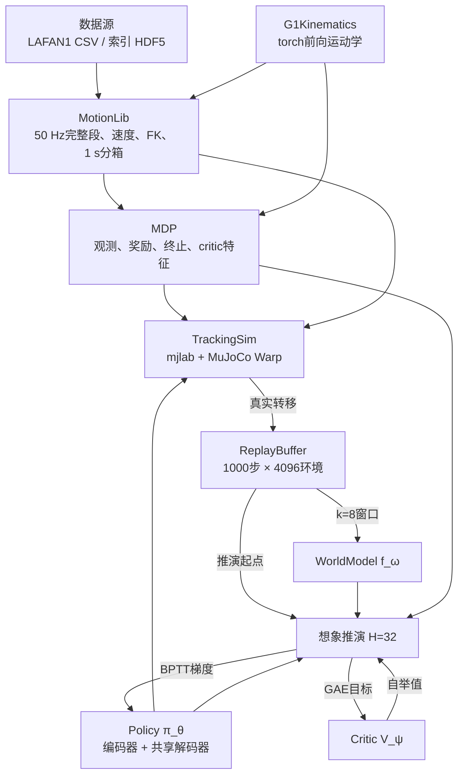
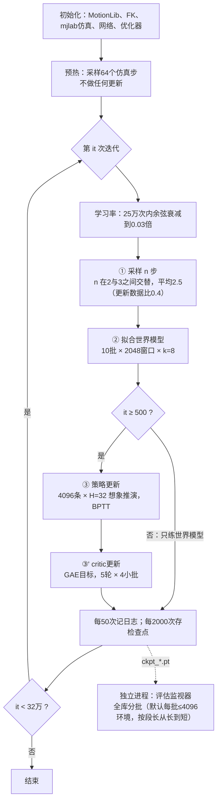
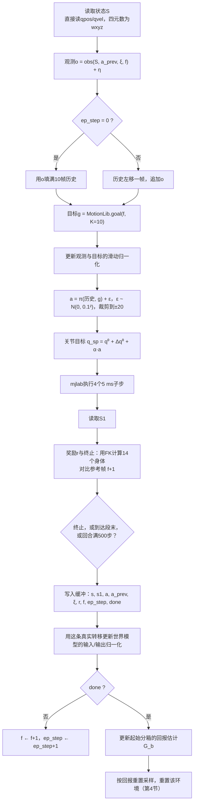
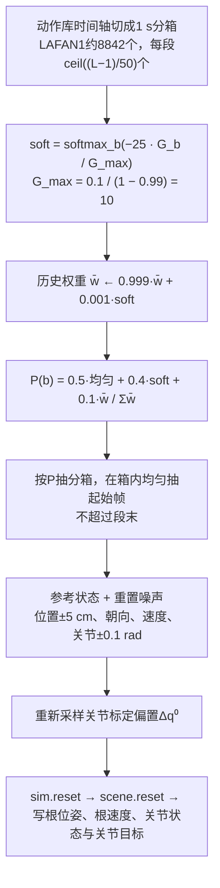
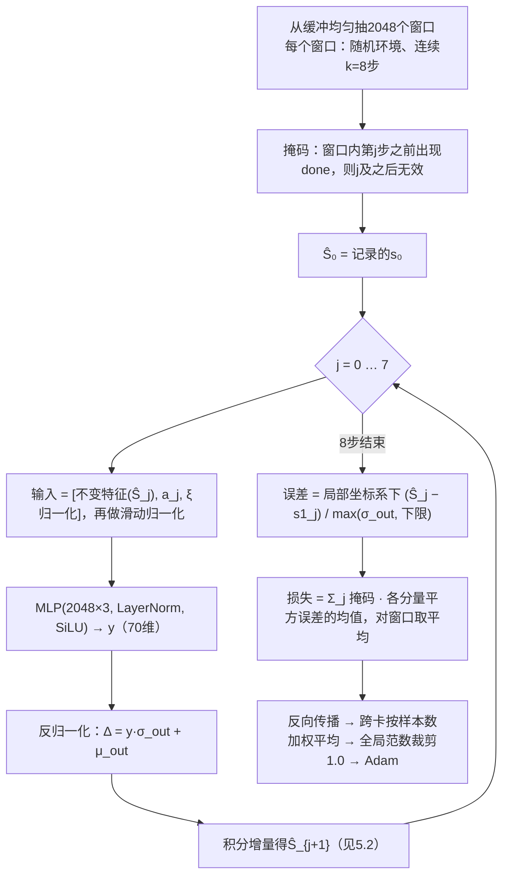
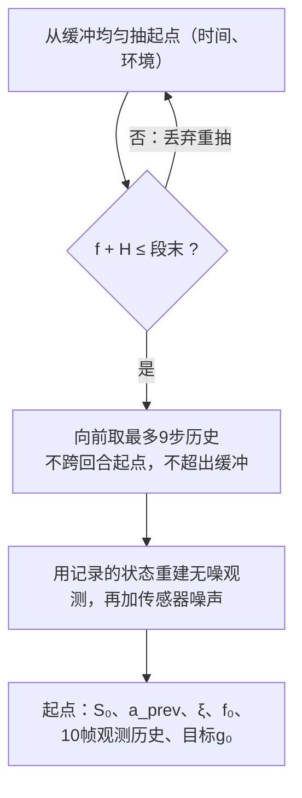
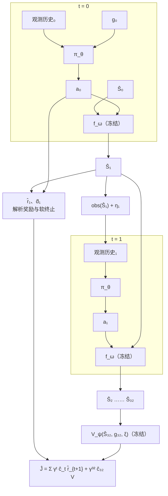
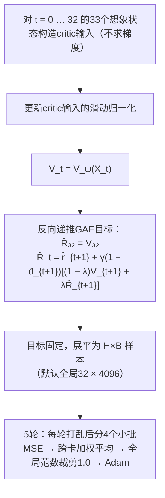
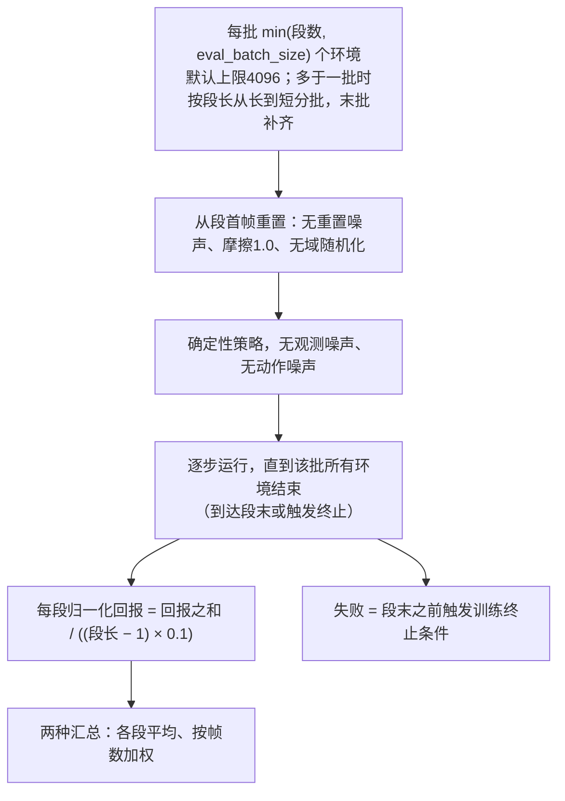

# SuperMimic训练流程与算法细节

- 依据：论文arXiv:2610.28480v1（以“论文”标注节号），以及本仓库当前实现（提交35b7e23加本次修复：参考朝向四元数存储、评估按段长分批、梯度有限性每迭代检查一次、多卡批量口径选项；以文件路径标注）。
- 与[algorithm.md](algorithm.md)的分工：那份讲论文层面的算法思路与风险；本文按训练流程逐步展开，
  给出流程图、公式、张量维度和实现细节，并在第11节列出实现与论文的差异。
- 公式的逐项拆解、通俗解释与数值算例见[formulas.md](formulas.md)，本文中的公式都标了对应章节。
- 维度与数值均按默认参数：全局4096环境（多卡时按进程拆分）、H=32、k=8、K=10。
- 数据支持LAFAN1 CSV与索引白名单HDF5两个入口，训练与评估共用；多卡用torchrun自动分片。

## 1. 全局视图

### 1.1 模块关系

| 模块 | 文件 |
| --- | --- |
| MotionLib | `supermimic/tasks/tracking/motion.py` |
| IndexedG1Dataset（索引白名单读取） | `supermimic/tasks/tracking/motion_hdf5.py` |
| 分布式上下文、梯度与全局统计同步 | `supermimic/utils/distributed.py` |
| G1Kinematics | `supermimic/utils/kinematics.py` |
| MDP | `supermimic/tasks/tracking/mdp.py` |
| TrackingSim | `supermimic/tasks/tracking/env.py` |
| ReplayBuffer | `supermimic/tasks/tracking/rl/buffer.py` |
| WorldModel、Policy、Critic | `supermimic/tasks/tracking/rl/networks.py` |
| 训练循环 | `supermimic/scripts/train.py` |

### 1.2 主循环（论文算法A.1）

每次迭代的工作量：

| 阶段 | 每次迭代 | 说明 |
| --- | --- | --- |
| ① 采样 | 4096 × 2.5 ≈ 1.0万条真实转移 | `step_acc += 1/utd`，取整数部分作为本次步数 |
| ② 世界模型 | 10 × 2048 × 8 = 16.4万次单步预测 | 每批独立一次反向传播与Adam更新 |
| ③ 策略 | 4096 × 32 = 13.1万条想象转移 | 一次前向展开、一次反向传播 |
| ③' critic | 13.1万样本 × 5轮，每轮4个小批（每批32,768） | 共20次Adam更新 |

多卡时默认（`--batch_scope global`）上表的批大小是全局总量：`--num_envs`、`--wm_batch`、`--pi_batch` 由各rank按均分规则拆分，
余数分给靠前的rank；`--batch_scope per_gpu`则把它们解释为每卡大小（论文表A.5口径）。
每个rank只加载自己的动作分片，各自运行仿真与回放缓冲，更新前跨卡同步梯度。

## 2. 数据与张量约定

### 2.1 数据源与参考张量

训练与评估共用两个数据入口，二选一：

| 入口 | 参数 | 读取与处理 |
| --- | --- | --- |
| LAFAN1 CSV | `--motion_dir`（默认`data/lafan1_g1`） | 30 fps线性插值加四元数slerp重采样到50 Hz；`--motion_limit` 取排序后的前N个文件 |
| 索引 HDF5 | `--motion_index`，可选`--motion_root` | paired index只当动作身份白名单：按`g1_h5`与`g1_source_clip_index`定位源段，长度和起点取自源库`source_clip_starts/lengths`的完整动作，不读配对窗口，也不读存储裁剪窗 |

- 索引旁必须有原`run.json`：它绑定G1关节顺序、源库manifest的SHA256与各分片的字节数/修改时间/SHA256；
  索引文件自身声明格式、`complete`与50 Hz。源库搬迁后用`--motion_root`指向新位置，内容仍需匹配；路径必须是源根内的相对POSIX路径。
- 索引声明50 Hz且`complete`；源段不足两帧、非50 Hz、身份重复、越界或校验和变化都会报错；
  分片SHA256只在`--verify_hashes`或字节数/修改时间变化时重算。
- `--motion_limit` 在分片前作用于全局选择，两个入口语义一致。不足33帧的动作保留，只是不能提供完整的32步想象起点。
- 参考张量按原始动作逐段独立构造：根线速度与关节速度用中心差分、根角速度用旋转中心差分，
  再用mjlab内置默认G1做FK；差分不跨动作边界，未来目标帧只在段尾钳制。
- 时间轴按1 s分箱：每段`ceil((长度−1)/50)`个箱；索引入口的全局分箱数按整个白名单统计，多卡时每卡只持有本地分箱。
- 生成`reference.json`并写入检查点：索引路径的指纹由索引SHA256、源分片SHA256、长度策略与所选段清单决定，
  CSV路径的指纹由文件名、文件SHA256与源帧率决定；恢复训练或评估时指纹不一致直接报错，显式`--motion_limit`子集有独立指纹。
- 参考张量常驻所选设备。根与14个身体的朝向存为四元数（`RotationView`），按帧索引时才转成旋转矩阵，
  调用方仍写`motion.root_R[f]`、`motion.body_R[f]`。每帧`4×(77+13×跟踪刚体数)+16` = 1,052字节，
  比存3×3矩阵（1,356字节）少22%：本索引全量约38.85 GiB，论文全量BONES-SEED约46.66 GiB。
  加载前按1.1倍加2 GiB余量检查显存，不足时报错，不自动缩减数据。
  代价是每次取用多一次四元数转矩阵；在RTX 4070 Ti SUPER、无`torch.compile`时，策略与critic阶段约慢4%。

### 2.2 状态、上下文与观测

| 量 | 维度 | 组成 |
| --- | --- | --- |
| 状态S | 71（扁平存储） | 根位置p 3、根朝向四元数4（运行时转为旋转矩阵R）、根线速度v 3、根角速度w 3（均为世界系）、关节角q 29、关节速度q̇ 29 |
| 仿真上下文ξ | 33 | 摩擦1、关节标定偏置29、躯干质心偏置3；输入网络前按区间中心和半宽归一化（`normalize_xi`） |
| 观测o | 99 | 论文的93维（q − q⁰ − Δq⁰ 29、q̇ 29、根系角速度3、投影重力3、上一动作29），另加参考根相对机器人根的朝向（6D）6维 |
| 观测历史 | 10 × 99 | 最新一帧在最后；回合第一步用当前帧填满10帧 |
| 目标g | 730 = 10 × 73 | 未来10帧，每帧：相对当前参考根的位置3、朝向6D 6、根系线速度3、根系角速度3、q 29、0.1 × q̇ 29 |

传感器噪声（论文表A.1，均匀分布半宽）：q 0.01 rad，q̇ 0.5 rad/s，角速度0.2 rad/s，投影重力0.05，上一动作无噪声，
实现额外给参考相对朝向加0.05。

### 2.3 网络输入输出

| 网络 | 输入 | 输出 | 结构 |
| --- | --- | --- | --- |
| 世界模型f_ω | 133 = 不变特征71 + 动作29 + ξ归一化33 | 70维局部增量 | MLP(2048, 2048, 2048)，LayerNorm + SiLU，末层零初始化 |
| 运动编码器 | 目标730 | z ∈ (−1, 1)³²（tanh） | MLP(2048, 1024, 512, 256)，ELU |
| 共享解码器 | z 32 + 观测历史990 | 动作29 | MLP(2048, 1024, 512, 256)，ELU，末层权重×0.01 |
| Critic V_ψ | 914 = 不变特征71 + 关节误差29 + 14个身体位置误差42 + 根位置误差3 + 参考相对朝向6 + ξ归一化33 + 目标730 | 标量 | MLP(256, 128)，ELU |

不变特征（`invariant_features`，71维）：根高度1、去掉偏航后的根朝向6D 6、根系线速度3、根系角速度3、q 29、q̇ 29。
它与机器人的水平位置和朝向无关，所以世界模型对平移和转向天然等变。

### 2.4 回放缓冲

按 (时间, 环境) 二维布局，环形覆盖最旧的一行。每条记录：

| 字段 | 维度 | 用途 |
| --- | --- | --- |
| s、s1 | 71、71 | 转移前后状态；s1单独存，这样跨回合的窗口也能拿到正确的目标 |
| a、a_prev | 29、29 | 实际执行的加噪动作、上一动作 |
| ξ | 33 | 该转移所在回合的上下文 |
| r | 1 | 仿真奖励（训练时只用于统计） |
| f | 1（int64） | 参考帧索引 |
| ep_step | 1（int32） | 回合内步数，用于重建观测历史 |
| done | 1（bool） | 终止或超时，用于窗口掩码 |

每条约949字节；全局4096环境的缓冲约3.9 GB，多卡时每卡各存一份、按每卡环境数缩放。

## 3. ① 采样：一个控制步

要点：

- **动作映射**（论文附录A）： $q^{\mathrm{sp}} = \alpha a + q^0$ ，其中 $\alpha = 0.25\, \tau_{\max} / K_p$ （力矩上限除以刚度），取自mjlab内置G1配置。
  实现把关节标定偏置 $\Delta q^0$ 同时加在目标和观测上，即 $q^{\mathrm{sp}} = q^0 + \Delta q^0 + \alpha a$ ，
  观测为 $q - q^0 - \Delta q^0$ ：机器人以为自己在 $q - \Delta q^0$ ，这正是“标定误差”的含义。
- **奖励**（论文表A.2，`MDP.reward`）：

  $$
  r_{t+1} = \Delta t \left( r^{\mathrm{track}} + r^{\mathrm{reg}} \right), \quad \Delta t = 0.02
  $$

  $$
  r^{\mathrm{track}} = e^{-\bar{e}_{\mathrm{pos}}/0.3^2} + e^{-\bar{e}_{\mathrm{ori}}/0.4^2} + e^{-\bar{e}_{\mathrm{lv}}/1.0^2} + e^{-\bar{e}_{\mathrm{av}}/3.14^2} + 0.5\, e^{-e_{\mathrm{rp}}/0.3^2} + 0.5\, e^{-e_{\mathrm{ro}}/0.4^2}
  $$

  $$
  r^{\mathrm{reg}} = -0.1 \lVert a_t - a_{t-1} \rVert^2 - 2 \sum_j \left[ \max(0, q_j - q_j^{\max}) + \max(0, q_j^{\min} - q_j) \right]
  $$

  $\bar{e}$ 为14个跟踪身体的平均平方误差（位置、朝向测地角、线速度、角速度）， $e_{\mathrm{rp}}$ 、 $e_{\mathrm{ro}}$ 为根的位置与朝向误差；
  $q_j^{\max}$ 、 $q_j^{\min}$ 是按0.9系数收缩后的软限位。追踪项满分5，所以单步最大奖励为 $5 \Delta t = 0.1$ 。
  通俗地说：六项打分衡量“像不像”，两项惩罚防止“乱来”，乘 $\Delta t$ 让每秒能拿的分与控制频率无关；指数核的直觉、“重新锚定”的推导和完整算例见[formulas.md](formulas.md)第2节。
  身体位置与朝向误差先把参考身体“重新锚定”到机器人根的水平位置和偏航（BeyondMimic做法），
  所以只惩罚姿态和相对位置，不惩罚整体平移漂移；全局漂移由根位置项惩罚。
- **终止**（论文附录A）： $e_z = \lvert z_{\mathrm{ref}} - z \rvert > 0.25\ \mathrm{m}$ ，或 $e_{\mathrm{tilt}} = \lvert (R_{\mathrm{ref}})_{33} - R_{33} \rvert > 0.8$ 。
  后者正是“参考与机器人根系中重力方向z分量之差”，直立参考下约78°（推导见[formulas.md](formulas.md)第3.1节）。
- **超时**：到达段末或回合满500步（10 s）。超时不是失败。
- **分箱回报估计**：回合结束时，用折扣回报更新起始分箱：

  $$
  G = \sum_{t=0}^{T-1} \gamma^t r_{t+1} + \mathbb{1}_{\mathrm{timeout}} \cdot \frac{\gamma^T \bar{r}}{1 - \gamma}, \qquad G_b \leftarrow 0.8\, G_b + 0.2\, G
  $$

  $T$ 为回合步数， $\bar{r}$ 为该回合平均每步奖励；超时时 $\mathbb{1}_{\mathrm{timeout}} = 1$ ，终止时为0。
  超时的回合用平均奖励把回报外推到无穷远，避免短回合的分箱被误判为“难”（等比数列推导见[formulas.md](formulas.md)第8.2节）。
- **多卡采样**：每卡只跑本地环境，`sim_steps`按全局环境数累计；回合结束统计在记日志时跨卡汇总，并按结束回合数加权。

## 4. 按回报重置采样（论文附录D.1）

抽样分布：

$$
P(b) = \frac{0.5}{N_{\mathrm{bin}}} + 0.4\, \mathrm{softmax}_b\left( -25\, \frac{G_b}{G_{\max}} \right) + 0.1\, \frac{\bar{w}_b}{\sum_{b'} \bar{w}_{b'}}, \qquad G_{\max} = \frac{0.1}{1 - 0.99} = 10
$$

其中 $\bar{w}_b \leftarrow 0.999\, \bar{w}_b + 0.001\, \mathrm{softmax}_b(\cdot)$ 是历史权重。系数−25有多“尖”、三种成分各起什么作用，见[formulas.md](formulas.md)第8.3–8.4节的算例。

- $G_b$ 越低（越难），softmax权重越大；系数−25让分布很尖锐，难点会被集中练习。
- 10%的历史权重让学会之后的难点仍保留一定练习量，防止遗忘。
- 多卡时softmax的max与分母、历史权重的EMA都按全局归约计算，但每卡只在本地分片的分箱上按条件分布抽样；
  这样各卡同步更新，却不保证与单卡全库自适应采样、回放轨迹或随机序列逐步等价。
- 重置顺序很关键：mjlab的`scene.reset`会把关节目标清零，所以必须先reset，再写入新状态和目标。

## 5. ② 世界模型拟合

### 5.1 流程

每次迭代重复10次，每次独立抽样和更新。多卡时每次更新先跨卡平均梯度（按本地窗口数加权）再做裁剪。
梯度是否为有限值记在GPU上的标志里，每次迭代只检查一次（在记日志和存检查点之前），出现非有限值即中止训练；
逐次检查会在每次迭代引入30次主机同步（世界模型10次、critic 20次），实测世界模型阶段因此慢约8%。

### 5.2 增量参数化

网络不直接输出下一状态，而是输出在机器人局部坐标系中的增量，再积分回世界系：

$$
p' = p + H_{\mathrm{yaw}}\, \Delta p, \qquad R' = R \exp\left( [\Delta\theta]_\times \right)
$$

$$
v' = v + R\, \Delta v, \qquad w' = w + R\, \Delta w, \qquad q' = q + \Delta q, \qquad \dot{q}' = \dot{q} + \Delta \dot{q}
$$

$H_{\mathrm{yaw}}$ 是只保留偏航的旋转（水平位移在偏航系中表示，与朝向无关）； $\Delta\theta$ 是根坐标系中的旋转向量，
$[\cdot]_\times$ 为反对称矩阵； $\Delta v$ 、 $\Delta w$ 是根坐标系中的速度增量（罗德里格斯公式与逐项解释见[formulas.md](formulas.md)第5.4节）。

这样做的好处：

- 输入是不变特征、输出是局部增量，所以同一个动作在任意水平位置和朝向下得到相同的预测。
- 末层零初始化，网络初始输出为0，反归一化后等于增量均值，模型一开始就是“按平均变化外推”，训练稳定。
- 四元数到旋转矩阵、exp映射等积分步骤都是解析的，梯度可以精确地穿过去。

### 5.3 损失细节

- 误差在上一状态的局部坐标系中计算，与目标增量的定义一致。
- 每个分量除以输出增量的标准差，并设下限：位置3 mm、朝向0.005 rad、线速度0.02 m/s、角速度0.05 rad/s、
  q 3 mrad、q̇ 0.05 rad/s。下限防止几乎不变的分量（例如静止关节）被除以极小的数而主导损失。
- 写成公式（ $B$ 个窗口， $m_{ij}$ 为掩码， $e_{ij} \in \mathbb{R}^{70}$ 为第 $i$ 个窗口第 $j$ 步的局部坐标系误差， $\sigma$ 为输出增量标准差， $\epsilon$ 为上述下限）：

  $$
  \mathcal{L} = \frac{1}{B} \sum_{i=1}^{B} \sum_{j=1}^{k} m_{ij} \cdot \frac{1}{70} \sum_{d=1}^{70} \left( \frac{e_{ij,d}}{\max(\sigma_d, \epsilon_d)} \right)^2
  $$

- 论文式(1)还有奖励、观测、终止三项；本实现三者都是解析头，所以只有状态项（误差归一化、掩码与论文式(1)的逐项对照见[formulas.md](formulas.md)第5.5–5.6节）。
- 日志里的`wm_err8`是窗口最后一步（第8步）的归一化误差，对应论文图3(c)的指标形式，但“名义误差”的定义不同。

## 6. ③ 想象推演与BPTT

### 6.1 起点与观测历史

起点要求后面还有至少32帧参考，所以每段最后0.64 s不会成为推演起点。抽样重试最多256轮，仍凑不满就明确报错；
多卡时某张卡的分片完全没有合法起点会经`torch.distributed`协调报错，而不是无限重采样。

### 6.2 展开的计算图

“冻结”指参数不求梯度（`requires_grad=False`），但梯度仍然穿过它们对输入的雅可比。
对 $\theta$ 的梯度沿三条路径回传：

1. **动作 → 动力学**： $a_t \to f_\omega \to \hat{S}_{t+1} \to$ 之后所有奖励和终止。
2. **状态 → 观测 → 策略**： $\hat{S}_t \to \mathrm{obs} \to \pi_\theta \to a_t$ 。策略看到的观测本身取决于它之前的动作。
3. **动作平滑项**：奖励里的 $\lVert a_t - a_{t-1} \rVert^2$ 直接连着相邻两步的动作。

### 6.3 目标函数的计算

实现先只展开动力学，32步结束后再把所有 (H × B) 个状态一次性批量算奖励和软终止，因为奖励不会回灌到动力学：

软终止（用sigmoid平滑两个硬阈值， $\sigma$ 为sigmoid， $e_z$ 、 $e_{\mathrm{tilt}}$ 由 $\hat{S}_{t+1}$ 与参考帧 $f_{t+1}$ 算出）：

$$
\hat{d}_{t+1} = 1 - \left( 1 - \sigma\left( \frac{e_z - 0.25}{0.02} \right) \right) \left( 1 - \sigma\left( \frac{e_{\mathrm{tilt}} - 0.8}{0.04} \right) \right)
$$

存活权重累乘：

$$
\hat{c}_0 = 1, \qquad \hat{c}_{t+1} = \hat{c}_t \left( 1 - \hat{d}_{t+1} \right)
$$

目标与损失（ $\hat{r}_{t+1}$ 由 $\hat{S}_{t+1}$ 、 $a_t$ 、 $a_{t-1}$ 算出）：

$$
\hat{J} = \sum_{t=0}^{31} 0.99^t\, \hat{c}_t\, \hat{r}_{t+1} + 0.99^{32}\, \hat{c}_{32}\, V_\psi(\hat{S}_{32}, g_{32}, \xi), \qquad \mathrm{loss} = -\mathrm{mean}(\hat{J})
$$

sigmoid的取值表、存活权重的算例，以及“自举项约占目标73%”的计算，见[formulas.md](formulas.md)第3.2–3.3节与第6.2节。

更新步骤：反向传播 → 跨卡按本地样本数加权平均 → 全局范数裁剪1.0 → 逐元素裁剪到±0.1 → 范数为有限值时才执行Adam（ $\beta = (0.9, 0.95)$ ）。

## 7. ③' Critic更新

GAE目标（论文式3，从 $t = 31$ 反向递推到0）：

$$
\hat{R}_{32} = V_{32}, \qquad \hat{R}_t = \hat{r}_{t+1} + \gamma \left( 1 - \hat{d}_{t+1} \right) \left[ (1 - \lambda) V_{t+1} + \lambda \hat{R}_{t+1} \right], \qquad \gamma = 0.99,\ \lambda = 0.95
$$

$$
\mathcal{L}_V(\psi) = \mathrm{mean}_{t, b} \left( V_\psi(X_{t,b}) - \hat{R}_{t,b} \right)^2
$$

λ取0和1两个极端时公式退化成什么、为什么有效视野约17步，见[formulas.md](formulas.md)第7.3节。

- 只用想象转移训练，目标在本次推演内算一次后固定；没有目标网络（论文§3.3）。
- critic在本次迭代里先被策略目标用来自举，然后才更新，所以策略总是用上一版critic。
- critic输入含特权信息：ξ、机器人与参考的身体位置误差（在偏航系中）、关节误差等；策略看不到这些。
- 多卡时每个本地小批反传后先跨卡按样本数加权平均梯度，再做全局范数裁剪；日志里的32 × 4096是全局样本数。
- critic梯度的有限性与世界模型一样，每次迭代检查一次。

## 8. 时间线：学习率、预热与归一化

- 前500次迭代策略不更新，但仍用初始策略采样。解码器末层权重乘0.01，初始策略输出接近0，即接近默认姿态。
  这段时间让世界模型先在这种分布上学到基本动力学，避免策略一开始就在一个随机模型里优化。
- 三组滑动归一化各自的数据来源不同：

  | 归一化 | 用什么数据更新 |
  | --- | --- |
  | 策略的观测、目标 | 采样时的真实观测和目标 |
  | 世界模型的输入、输出 | 每条真实转移 |
  | critic输入 | 每次的想象状态 |

  累计样本数达到2×10⁸后冻结，避免训练后期的分布漂移把已学好的网络打乱。多卡时三组归一化的样本数、均值、方差都按全局聚合（含rank间方差），冻结计数也是全局计数。
- 回放缓冲与随机数状态不入检查点，所以恢复训练同样要先重新预热采样，恢复训练不是逐步续跑。
- 多卡由torchrun启动：入口读`WORLD_SIZE/RANK/LOCAL_RANK`，每进程绑定本地GPU并只加载自己的动作分片；
  `--num_envs`、`--wm_batch`、`--pi_batch`默认是全局总量，按rank均分、余数分给靠前的rank；
  `--batch_scope per_gpu`时是每卡大小，全局总量随卡数增长。
- 每次更新前先跨卡按本地样本数加权平均梯度，再统一裁剪；分箱softmax与历史权重也做全局归约。
  只有主进程写`train_log.csv`、`reference.json`与检查点，每个rank另写自己的分片清单。
- 检查点不带DDP前缀，可由单进程评估加载；恢复时只校验全局数据指纹，允许更换卡数并重新分片，
  但回放缓冲、仿真状态与随机数状态不恢复，因此多卡与单卡的结果不应假设逐步等价。
- 论文表A.5的双卡设置把学习率乘√2；`--lr_scaling sqrt`把基础学习率乘以√WORLD_SIZE（双卡即√2，更多卡是按同一规则外推），默认不缩放。
  复现论文双卡实验用`--batch_scope per_gpu --lr_scaling sqrt`。

## 9. 评估（论文附录F.1）

第 $c$ 段动作长 $L_c$ 帧，评估时最多走 $L_c - 1$ 步：

$$
\mathrm{NR}_c = \frac{\sum_t r_t}{(L_c - 1) \times 0.1}, \qquad
\mathrm{NR}_{\mathrm{mean}} = \frac{1}{C} \sum_c \mathrm{NR}_c, \qquad
\mathrm{NR}_{\mathrm{frame}} = \frac{\sum_c \sum_t r_t}{0.1 \sum_c (L_c - 1)}
$$

两种汇总的差别可以很大，算例见[formulas.md](formulas.md)第10.2节。

- 触发终止之后该环境不再计入回报，所以提前失败的动作得分低，与论文“提前终止得分低”的定义一致。
- 报告两种汇总，因为论文没有说明跨动作如何汇总。
- 评估固定单进程（torchrun多进程启动会直接报错）：`--eval_batch_size`（默认4096，论文每卡环境数）决定同时存在的环境数。
  一批要等最长的那段跑完，所以多于一批时先按段长从长到短排序再分批，使同批长度接近；只有一批时保持动作库顺序（轨迹录制依赖它）。
  末批用重复的非活跃环境补齐、不计入分数，结果按动作写回原位置，所以逐段分数与批大小和顺序无关。
- 每个检查点除写`eval.csv`一行外，还写同名`*_eval.json`（含逐动作归一化回报与失败清单）；
  `eval.csv`必须与`eval_reference.json`的数据指纹绑定，已有`eval.csv`但缺该文件时拒绝续写，避免混入不同数据集的分数。
- `--record`轨迹录制要求动作数不超过一个评估批次，需要显式调大`--eval_batch_size`；评估机需加载完整的所选参考库。
- `--watch`模式每60 s扫描一次新检查点，与训练进程并行；`--every`按迭代区间过滤检查点。

## 10. 每次迭代的计算量（粗估）

| 部分 | 前向规模 | 说明 |
| --- | --- | --- |
| 世界模型拟合 | 16.4万次 × 约9M参数，前向加反向 | 约9 × 10¹² FLOPs |
| 想象推演 | 13.1万步 × (世界模型约9M + 策略约9M) | 前向加反向约1.2 × 10¹³ FLOPs；世界模型参数不求梯度，但要对输入求导 |
| FK与奖励 | 13.1万步 × 30个刚体的链式变换 | 计算量小，但是逐体串行的小算子，适合`torch.compile`融合 |
| 仿真 | 约1.0万个控制步 × 4子步 | 取决于MuJoCo Warp吞吐 |

在Linux上`torch.compile`会把世界模型展开、单步推演、奖励和critic特征这几段编译融合；Windows上没有Triton，退回逐算子执行。

实测（RTX 4070 Ti SUPER，未编译）：每次迭代约6.8–7.0万个kernel，九成以上短于10 µs，数量几乎不随批量变化；512环境时GPU只有约三成时间在计算。瓶颈分析与优化项见[optimization.md](optimization.md)。

上表按全局批大小估算；多卡时每卡约承担1/N（余数按rank分配），每次迭代额外增加梯度all-reduce（世界模型10次、策略1次、critic约20次）以及归一化和分箱的同步开销。多卡路径面向Linux/NCCL；Windows多卡不在支持与验收范围内。

## 11. 实现与论文的差异

| 项 | 论文 | 本实现 | 影响 |
| --- | --- | --- | --- |
| 观测 | 93维 | 99维，加参考相对根朝向 | 策略可感知自身与参考的朝向差（BeyondMimic的`motion_anchor_ori_b`） |
| 世界模型状态 | 未完整说明 | 71维物理状态；上一动作在推演循环中单独传递 | 观测头可完全解析 |
| 预测头 | 学习或解析，未说明 | 奖励、观测、终止全解析；终止用sigmoid平滑 | 只拟合动力学；奖励与仿真严格一致 |
| 动力学参数化 | 绝对状态 | 不变特征输入、局部增量输出 | 平移与转向等变，训练更稳 |
| 软终止 | 学习的终止概率 | 由硬阈值平滑得到 | 不需要BCE项 |
| 摩擦、质心随机化 | 每回合 | 每个环境在启动时采样一次；关节偏置每回合采样 | ξ的多样性来自全局4096个环境（每卡本地环境各采一次） |
| 重置噪声 | 未提及 | 位置、朝向、速度、关节加均匀噪声 | 扩大状态覆盖 |
| 回合长度 | 未提及 | 500步（10 s）或到段末 | 同mjlab追踪任务的10 s |
| 世界模型预热 | 未提及 | 前500次迭代只练世界模型 | 避免早期在随机模型上优化策略 |
| 精度 | TF32 | MLP用bf16自动混合精度，积分、FK、奖励保持fp32 | 速度更快；与论文吞吐不可直接对比 |
| 自碰撞 | 只删掉惩罚项，未说明仿真是否开启 | mjlab默认开启 | 与参考实现（关闭）结果不可直接对比 |
| 更新数据比0.4 | 未定义 | 每次迭代每环境平均2.5个仿真步 | 按“每个环境步0.4次更新”理解 |
| 数据入口 | LAFAN1 30 fps（论文另有大规模动作库） | CSV重采样50 Hz；索引HDF5取原生50 Hz完整源段（身份白名单选择，不裁剪） | 支持BONES-SEED索引数据；配对窗口与存储窗口不参与 |
| 参考速度与FK | 未说明 | 每个原始动作独立中心差分速度/角速度，再用mjlab内置默认G1做FK | 差分与未来帧不跨段边界 |
| 多卡训练 | 2卡，每卡4096环境，学习率×√2（表A.5） | torchrun自动分片：默认全局批大小均分、不放大学习率；`--batch_scope per_gpu --lr_scaling sqrt`对应论文口径；梯度按样本数加权平均、全局归一化 | 同步更新，但采样与随机序列不保证与单卡逐步等价 |
| 数据指纹 | 未提及 | 索引/源分片SHA256与所选段清单写入`reference.json`与检查点，恢复与评估校验 | 换卡数可恢复，但数据一变即报错 |
| 评估 | 附录F.1，逐条动作 | 单进程分批（默认每批≤4096环境，按段长从长到短），逐检查点`*_eval.json`，数据指纹绑定 | 显存有界，可增量评估；轨迹录制限单批 |
