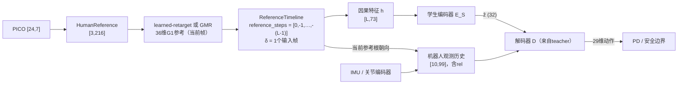
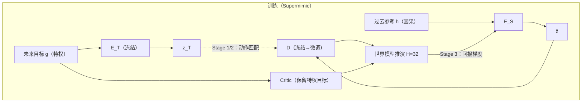

# 实时遥操作：因果意图编码器（方案D）

- 依据：Supermimic `c00864c`（2026-10-28）的实现；Teleopit（`Bote_Teleopit`，rara上`D:\Train\Bote_Teleopit`）`4023a6b`的learned-retarget契约、参考时间线与sim2real运行时。Teleopit的路径均相对其仓库根目录。
- 状态：**设计稿**。文中没有任何实现、训练或测量结果；所有“预期”均待第10节的里程碑验证。
- 记号沿用[训练流程](../analysis/training_pipeline.md)：控制周期 $`\Delta t=0.02\,\mathrm{s}`$（50 Hz），未来帧数 $`K=10`$，观测历史 $`H_o=10`$，想象时域 $`H=32`$。

## 0. 结论

Supermimic策略本身就是“目标编码器 + 共享解码器”：

```math
\begin{aligned}
z_t&=\tanh\bigl(E_T(g_{t+1:t+K})\bigr)\in[-1,1]^{32},\\
a_t&=D(z_t,\;o_{t-9:t}).
\end{aligned}
```

参考信息只能经由32维的 $`z`$ 进入解码器。方案D用一个**只看过去参考**的学生编码器 $`E_S`$ 替换 $`E_T`$，解码器 $`D`$ 原样保留：

```math
\begin{aligned}
\hat z_t&=E_S\bigl(h_{t-L+1:t}\bigr),\\
a_t&=D(\hat z_t,\;o_{t-9:t}).
\end{aligned}
```

对未来的预测在潜空间里隐式完成，部署时不必为凑齐未来帧而延迟播放参考。训练分三段：离线回归（动作匹配）、闭环DAgger、世界模型解析梯度微调；第三段让学生在未来不确定时直接优化跟踪回报，而不是回归到“平均意图”。

## 1. 两侧接口

### 1.1 Supermimic策略

| 量 | 定义 | 维度 | 代码 |
| --- | --- | --- | --- |
| 目标 $`g`$ | 帧 $`f+1\ldots f+K`$，钳制到段末帧；每帧在当前参考帧的水平朝向下表达位移、rot6d朝向、局部线/角速度、`q`、`0.1·qd` | $`73K=730`$ | [motion.py:271](../../supermimic/tasks/tracking/motion.py:271) |
| 观测 $`o`$ | `q - q0 - dq0`、`qd`、本体角速度、重力方向、`a_prev`、`rel` | 99 | [mdp.py:101](../../supermimic/tasks/tracking/mdp.py:101) |
| `rel` | $`\mathrm{6d}(R^\top R_{\mathrm{ref}}[f])`$，机器人与**当前**参考根的完整相对朝向 | 6 | 同上 |
| 策略 | `enc: 730→32`（tanh），`dec: 32+10×99→29` | — | [networks.py:123](../../supermimic/tasks/tracking/rl/networks.py:123) |

速度由离线中心差分得到（[motion.py:174](../../supermimic/tasks/tracking/motion.py:174)），会用到下一帧。数据约定与Teleopit一致：四元数wxyz，29个关节为Unitree顺序，Supermimic也直接读取`teleopit_motion_hdf5`。

### 1.2 Teleopit

- learned-retarget（`docs/docs/reference/sonic-phase-b-direct-pico-plan.md`）：PICO `[24,7]` → HumanReference `[3,216]`（50 Hz，3个因果样本，会话锚点坐标系）→ Human encoder（64维潜变量）→ decoder → **36维G1参考**（根xyz、四元数wxyz、29关节）。截至`4023a6b`没有发布的检查点；生产路线仍是在线GMR，输出同样是G1参考。
- 参考时间线（`teleopit/sim/reference_timeline.py`）：参考帧按时间戳入队，策略周期按 $`t_{\mathrm{base}}=t_{\mathrm{now}}-\delta`$ 取样。`reference_steps`格式为`[0, 未来…, 历史(负数)…]`；`validate_runtime_support`要求 $`\delta\ge s_{\max}\Delta t`$（$`s_{\max}`$ 为最远的未来步），窗口长度 $`\ge\delta+\lvert s_{\min}\rvert\Delta t`$。现有配置都是`reference_steps: [0]`，$`\delta`$ 默认等于一个输入帧（$`1/\mathrm{grid\_hz}`$）。
- 高层策略的sim2real路线（`teleopit/sim2real/mp/high_level_policy_runtime.py`）强制`reference_steps == [0]`，不能用于本方案。

## 2. 未来帧问题与备选方案

$`E_T`$ 需要 $`f+1\ldots f+10`$，实时输入只到当前帧。

| 方案 | 做法 | 额外延迟 | 主要代价 |
| --- | --- | --- | --- |
| A 延迟缓冲 | `reference_steps: [0..11]`，$`\delta\approx0.22\text{–}0.24\,\mathrm{s}`$ | 约220 ms | 策略输入与训练一致，但人能明显感到滞后 |
| B 缩小K | `--goal_frames`取5、3或1重训 | $`K\Delta t`$ | 前瞻变短，跟踪质量下降程度未知 |
| C 截断视野训练 | 训练时随机截断未来帧并给出有效视野标记 | 3–5帧 | 截断后的帧仍是保持值，信息量有限 |
| **D 因果意图编码器** | 学生从过去参考预测 $`z`$ | 约1个输入帧（可选再加 $`d`$ 帧） | 需要蒸馏与微调；突发动作的起始仍受物理滞后限制 |

D把“要不要等未来帧”变成“学生能预测多少”，而且teacher的 $`K`$ 与部署延迟脱钩：若更长前瞻（如 $`K=20`$ 或 $`25`$）让teacher更好，可以直接加大，代价只是学生更难学。A仍是有价值的对照组（第8节）。

## 3. 总体结构





## 4. 关键设计决策

### 4.1 学生输入：G1参考历史（D1）还是人体历史（D2）

| | D1：G1参考历史 → $`\hat z`$ | D2：人体历史 → $`\hat z`$ |
| --- | --- | --- |
| 学生的任务 | 只在G1空间预测未来意图 | 重定向与预测合一 |
| 训练数据 | Supermimic整个动作库，不需要配对 | 只能用配对数据（Teleopit文档自认分布偏窄） |
| 误差 | 重定向误差会传入，需要噪声模型（第6节） | 不经过36维中间量，没有两级误差叠加 |
| 依赖 | 可先接在线GMR，不等learned-retarget发布 | 依赖人体特征契约 |
| `rel` | 直接用当前帧G1参考 | 需要辅助头预测当前根朝向 |

**先做D1。**它能在Supermimic内完整训练与评测，回答“$`z`$ 能否被预测”这一核心问题。D2留到D1收敛之后；Supermimic已能读取`mjbones_human23_g1_nominal`配对索引（[motion_hdf5.py:17](../../supermimic/tasks/tracking/motion_hdf5.py:17)），人体一侧的数据是现成的。

### 4.2 `rel`的来源

`rel`依赖当前参考根的完整朝向（含偏航）。D1用时间线上当前帧的G1参考，延迟只有一个输入帧。arm时记录PICO会话锚点与机器人IMU之间的偏航差，使arm瞬间 `rel` 的偏航分量为零；会话重置时一并清除。这与训练中从参考状态起步（`rel`接近单位阵）的分布一致。

### 4.3 历史特征必须严格因果

新增`MotionLib.history(f, L)`，与`goal(f, K)`对称：

- 取帧 $`f-L+1\ldots f`$，段首不足 $`L`$ 帧时用段首帧补齐。这与`_collect_action`对新回合用首个观测填满历史的语义一致。
- 每帧73维，布局与目标帧相同，全部表达在帧 $`f`$ 的水平朝向下，因此对平移和偏航不变。
- 线速度、角速度、`qd`用**后向差分**重算，不能复用`MotionLib`的中心差分，否则训练时偷看了1帧未来。

需要一个单元测试：改动帧 $`f+1`$ 及以后的参考，`history(f, L)`逐位不变。

### 4.4 延迟旋钮 $`d`$（可选）

$`d=0`$ 时跟踪目标就是当前参考帧，执行器滞后全靠预测补偿。也可以让目标取帧 $`t-d`$，学生看到 $`t-d`$ 之后的 $`d`$ 帧真实未来（$`d=1\text{–}3`$，即20–60 ms），得到连续可调的延迟与精度取舍。每个 $`d`$ 单独训练一个学生；部署时 $`\delta`$ 相应加 $`d\Delta t`$。

### 4.5 让teacher对学生友好

当前 $`z`$ 是确定性的，只为控制训练，解码器对 $`z`$ 的小误差可能很敏感。建议重训teacher时在潜变量上加噪声：

```math
\begin{aligned}
a_t&=D\bigl(\mathrm{clip}(z_t+\sigma\epsilon,\,-1,\,1),\;o_{t-9:t}\bigr),\\
\epsilon&\sim\mathcal N(0,I),\quad \sigma\in[0.05,0.1].
\end{aligned}
```

这一步直接决定学生的上限，应在M1发现回归误差大时优先做（第10节）。

## 5. 训练流程

### 5.1 Stage 0：teacher

用现有检查点即可开始M1；若M1显示 $`z`$ 不可预测或解码器过敏，再按4.5节加潜变量噪声重训，必要时加大 $`K`$。

### 5.2 Stage 1：离线回归

从动作库采样帧 $`f`$（排除 $`f>\mathrm{clip\_end}-K`$ 的帧：那里的目标被钳制成“停下”，学生从历史无从知道段落将结束），观测 $`o`$ 取自回放缓冲区的真实状态。损失以动作匹配为主：

```math
\begin{aligned}
\mathcal L_1
&=\bigl\lVert D(\hat z,o)-D(z_T,o)\bigr\rVert_2^2\\
&\quad+\lambda_z\bigl\lVert\mathrm{atanh}(\hat z)-\mathrm{atanh}(z_T)\bigr\rVert_2^2.
\end{aligned}
```

$`\lambda_z`$ 取较小值。动作匹配按解码器的灵敏度自动给 $`z`$ 的各维加权，比单纯的潜变量MSE更接近目标。`atanh`前对 $`z`$ 截断到 $`\lvert z\rvert\le1-10^{-4}`$。

$`E_S`$ 用Conv1d时序编码器（结构可参照Teleopit `train_mimic/tasks/tracking/rl/conv1d_encoder.py`），$`L=25\text{–}50`$（0.5–1 s），输出前接tanh。

### 5.3 Stage 2：闭环DAgger

在`TrackingSim`中用学生动作推进，teacher在学生实际访问到的状态上，用真实未来目标给出动作标签；数据累积后按 $`\mathcal L_1`$ 继续训练。修正离线回归的协变量偏移。

### 5.4 Stage 3：世界模型解析梯度微调

回归得到的是 $`\mathbb E[z_T\mid h]`$；未来有多种可能时（可能出脚，也可能不出），平均意图不等于最优动作。`_policy_step`本来就是“经冻结的世界模型推演 $`H`$ 步并对回报反传”（[trainer.py:328](../../supermimic/tasks/tracking/rl/trainer.py:328)），只需把策略的目标输入换成历史：

```math
\begin{aligned}
\hat J
&=\sum_{t=0}^{H-1}\gamma^t\hat c_t\,r\bigl(\hat s_{t+1}\bigr)\\
&\quad+\gamma^H\hat c_H V_\psi(\hat s_H,g_H,\xi),\\
a_t&=D\bigl(E_S(h_t),o_t\bigr).
\end{aligned}
```

- critic继续使用真实未来目标 $`g`$（非对称actor-critic）；它只在训练中使用，看到特权信息没有问题。
- 先冻结 $`D`$ 只训 $`E_S`$；稳定后以小学习率解冻 $`D`$，加锚定项 $`\beta\lVert D(\hat z,o)-D_T(z_T,o)\rVert^2`$ 防止遗忘。

### 5.5 代码改动点

| 位置 | 改动 |
| --- | --- |
| `supermimic/tasks/tracking/motion.py` | 新增`history(f, L)`（后向差分、段首补齐） |
| `supermimic/tasks/tracking/rl/networks.py` | `Policy`拆出可替换的编码器；新增`CausalEncoder` |
| `supermimic/tasks/tracking/rl/trainer.py` | `_imag_step`、`_collect_action`、`policy_update`的策略输入改为历史；Stage 1/2的蒸馏循环 |
| `supermimic/scripts/evaluate.py` | 支持学生检查点；记录与实时参考的误差 |
| `supermimic/utils/checkpoints.py` | 保存teacher来源、$`L`$、$`d`$、特征版本 |
| `tests/` | 因果性测试（4.3节）；学生与teacher共享解码器的形状检查 |

## 6. 数据与噪声

- **观测参考与目标参考分离。**部署时 $`E_S`$ 看到的是在线重定向输出，比离线数据噪声大。理想做法是`MotionLib`每帧带两份参考：观测参考（learned-retarget在Teleopit配对数据`pico_nominal`配置下离线推理的输出）供 $`E_S`$ 使用；干净的GMR参考用于目标、`rel`与奖励。过渡方案是统计重定向输出相对GMR的逐关节残差标准差与时间相关性，按统计注入噪声。
- **速度放大。**后向差分把逐帧抖动放大 $`1/\Delta t=50`$ 倍：$`1^\circ`$ 的抖动约等于 $`0.87\,\mathrm{rad/s}`$。噪声注入应在位置层面进行，再差分，而不是直接在速度上加独立噪声。
- **扰动增广。**对齐Teleopit `train_mimic/configs/datasets/learned_retarget_pico.yaml`的`pico_nominal`：1–3帧保持（dropout）、时间戳抖动、会话开头历史不足。
- **动作分布。**遥操作中站立、上肢动作占比通常高于LAFAN类数据，应把Teleopit录制的PICO动作（`scripts/run/record_pico_motion.py`）转成G1参考后加入动作库。

## 7. 部署与Teleopit对接

### 7.1 ONNX契约

| 输入 | 形状 | 说明 |
| --- | --- | --- |
| `ref_hist` | `[1, L, 73]` | 4.3节的因果特征，最新帧在最后 |
| `obs_hist` | `[1, 10, 99]` | 未归一化观测；归一化统计量打包进图 |
| **输出** `action` | `[1, 29]` | 与训练相同的动作语义；动作到PD目标的换算与默认姿态需在接入时逐项核对 |

另附sidecar（JSON）：teacher与学生的检查点哈希、$`K`$、$`L`$、$`d`$、特征版本、关节顺序。

### 7.2 Teleopit侧配置与状态

- 新增`controller.kind`（如`supermimic_causal`），沿用`REFERENCE_TOPIC`与参考worker，不改GMR或learned-retarget实现。
- `reference_steps: [0, -1, …, -(L-1)]`；`retarget_buffer_delay_s`取默认一个输入帧再加 $`d\Delta t`$；`retarget_buffer_window_s`不小于 $`\delta+(L-1)\Delta t`$，由`validate_runtime_support`检查。
- arm/disarm与会话重置：清空参考时间线、特征历史、观测历史与偏航对齐。重启后历史用首帧补齐，与训练语义一致。
- 输入中断：时间线退化为`fallback_latest`时，参考保持不变；特征中的速度应置零，与保持帧的含义一致。

## 8. 评测

所有误差均相对**实时参考**计算；若相对延迟后的参考计算，A的220 ms滞后会被算成零误差。

| 组 | 说明 |
| --- | --- |
| T | teacher用真实未来，作为上限 |
| A | teacher + 11帧延迟：`evaluate.py --record`录轨迹，离线平移11帧后对实时参考算误差 |
| B | $`K\in\{5,3,1\}`$ 的teacher |
| D-1 / D-2 / D-3 | Stage 1、2、3的学生 |

- 指标：现有`norm_return`与失败数；根与关节跟踪误差（相对实时参考）；离线的 $`\hat z`$ 回归 $`R^2`$ 与动作匹配误差。
- 按可预测性分组：稳态行走与周期动作 vs. 突然起步、踢腿、转身。
- 分距离诊断：分别用只含 $`f+k`$ 一帧的目标训练线性探针，看 $`\hat z`$ 能预测到多远。
- 上真机前：Teleopit `pico_body_replay`回放录制数据跑sim2sim，与A组同一段输入对比。

## 9. 风险

| 风险 | 表现 | 应对 |
| --- | --- | --- |
| $`z`$ 对未来过敏 | Stage 1回归误差大、动作匹配差 | 4.5节潜变量噪声重训teacher；以动作匹配为主损失 |
| 未来多模态 | 学生输出“平均意图”，动作犹豫 | Stage 3以回报直接优化 |
| 突发动作的物理滞后 | 起始段误差无法消除 | 这是下限；用 $`d`$ 换取部分真实未来 |
| 历史特征泄漏未来 | 离线好、部署差 | 后向差分 + 4.3节因果性测试 |
| 重定向噪声分布偏移 | sim2sim抖动、误差放大 | 第6节观测参考与位置层噪声 |
| learned-retarget未发布 | 无法端到端测试 | D1先接在线GMR（同为36维G1参考） |
| 段末“停下”语义 | 学生在部署中误判停止 | Stage 1/2排除段末 $`K`$ 帧；Stage 3保留，让回报决定 |

## 10. 里程碑

| 里程碑 | 内容 | 进入下一步的条件 |
| --- | --- | --- |
| M1 | 现有teacher + `history(f, L)` + Stage 1离线回归；报告held-out上的动作匹配误差与分距离 $`R^2`$ | 行走类动作的动作匹配误差明显低于“零潜变量”基线；否则先做4.5节重训 |
| M2 | Stage 2、Stage 3；与T、A、B做闭环对比 | D-3相对实时参考的误差低于A |
| M3 | 观测参考与噪声模型；视结果启动D2 | 加噪后闭环指标退化可接受 |
| M4 | ONNX导出、Teleopit controller、sim2sim | 回放sim2sim稳定，延迟链路有实测记录 |

M1只需要现有teacher检查点与动作库，在bitahub上训练、Rara上做测试与诊断（连接方式见[平台与远程运维](../troubleshooting/platform_ops.md)）。
