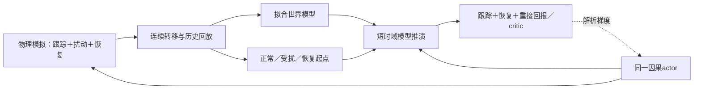

# 实时跟踪与统一扰动恢复设计

更新：2026-11-03；2026-11-04复核，并按实施前审查修订。状态：**设计稿，尚未实现或验证本文提出的组合方案**。保留原文件名，以保持已有链接有效。

本地实现基线为Supermimic `1fc30fe`。本次另只读检查了rara上的Supermimic `07dee275`与Teleopit `4023a6b`，具体差异、证据和待验证解释见[源码对比](teleopit_supermimic_comparison.md)。旧稿记录的Teleopit接口以本次源码检查及实施时的版本复核为准。2026-11-04另核对了Any2Track官方代码OpenTrack `cb9b751`、mjlab 1.4.0上游实现及第10节所列论文。

**版本基准**：依赖版本严格以本仓库`pyproject.toml`与`uv.lock`为准：mjlab 1.6.0、mujoco与mujoco-warp 3.11.0、warp-lang 1.18.0、rsl-rl-lib 5.4.2（由mjlab引入）。Teleopit锁定的mjlab 1.4.0与rsl-rl-lib 5.2.0不作为实验环境，文中对1.4.0行为的描述只用于解释Teleopit原生结果。本项目与Teleopit使用同一G1模型和参数。

## 0. 目标与主要决策

目标是一个可部署到G1的实时全身tracker：**只使用当前和历史参考，在受扰偏离后自主恢复，必要时自行起身，再接回持续更新的reference；同时尽量保留Supermimic的训练效率与跟踪精度。**

失衡、滑移、倒地和起身统一属于扰动恢复。按严重程度分组只用于训练覆盖和诊断，不把“会抗推”和“会起身”作为互不衔接的两个产品能力，也不预设必须部署两套policy。

| 要求 | 设计约束 | 验收依据 |
| --- | --- | --- |
| 无未来参考帧 | actor及线上特征仅依赖已到达的当前/历史信息；不为获得未来参考而延迟播放 | 前缀因果性检查、实时参考误差、实际延迟 |
| 统一扰动恢复 | 受扰后保持同一控制会话，自主恢复并接回当前指令 | 恢复成功率、恢复/重接时间、重接后持续跟踪 |
| 跟踪精度 | 保留正常动作训练，直接评测姿态、速度、末端与根误差 | 同数据、同时序、同物理模型的独立评测 |
| 训练速度 | 以Supermimic世界模型解析梯度为主候选，保留匹配条件的PPO对照；恢复任务上是否仍为主候选，先由M1b探针检查 | 达到联合精度/恢复门槛的墙钟时间与GPU-hours |
| 实时部署 | 50 Hz策略、200 Hz PD为初始配置；控制循环内只运行因果actor及必要特征计算 | 目标设备上的控制耗时、超时率、端到端延迟 |

借鉴分工：Supermimic提供世界模型训练闭环；Teleopit提供当前观测直通、历史CNN、实时参考处理和难段采样；Any2Track提供用较长本体历史、以世界模型预测为代理任务学习动力学表示的思路；恢复课程参考StableMimic和RGMT。下面的组合是本项目的设计，不能把各论文的独立结果直接相加为性能保证。

旧稿的“未来编码器→学生编码器→固定共享解码器”不再是唯一主线。首选候选改为**当前观测直通＋历史编码，在世界模型中直接优化回报**。教师蒸馏保留为可选初始化，不要求先重训更长前瞻teacher，也不以强制增加部署延迟弥补因果策略的精度。

## 1. 当前实现与缺口

| 模块 | 已有行为 | 本设计需要补充的行为 |
| --- | --- | --- |
| `MotionLib.goal` | 默认读`f+1…f+10`；参考速度使用中心差分 | 单独的因果actor参考处理；原未来目标只供对照或训练特权通路 |
| `Policy` | 730维未来目标编码为32维，拼接10×99维历史后输出29维动作 | 显式当前目标通路＋因果历史编码；部署信息边界可检查 |
| `WorldModel` | `s,a,xi`预测状态增量；`xi`覆盖摩擦、关节零位、躯干质心 | 扰动、倒地、复杂接触转移的数据覆盖及相应动力学上下文 |
| `TrackingSim` | 从参考状态附近初始化；大偏差触发终止 | 在参考持续推进时保留恢复过程；加入受扰轨迹与恢复初始化 |
| `MDP` | 根高度/倾斜偏差决定硬终止；`soft_survival`抑制后续想象回报 | 恢复窗口内允许可恢复偏差；偏离程度与存活概率分开定义，硬/软终止及critic目标保持一致 |
| `ReplayBuffer` | 保存物理转移、参考帧号和回合边界 | 保存扰动上下文、训练课程标签与重接信息；因果参考在阶段B由帧号与回合步数重建，阶段D起才需保存处理状态（见第6节） |
| 评估 | 主要按完整参考片段计回报及失败 | 增加严格因果、实时精度、统一扰动恢复和达标时间评估 |

源码入口：[motion.py](../../supermimic/tasks/tracking/motion.py)、[networks.py](../../supermimic/tasks/tracking/rl/networks.py)、[trainer.py](../../supermimic/tasks/tracking/rl/trainer.py)、[env.py](../../supermimic/tasks/tracking/env.py)、[mdp.py](../../supermimic/tasks/tracking/mdp.py)。

Teleopit的rewind会在失败回合结束后重置机器人到更早的参考状态，不能代替不中断的物理恢复。其当前帧配置也不能直接作为严格因果保证：这一帧相对重置状态提前一个控制步（见2.3节），离线预计算速度也使用了中心差分，需要与线上特征生成一起修改或重算。

## 2. 信息边界与参考时间线

### 2.1 因果性定义

在控制时刻`t`，部署actor只能使用截至`t`已经到达的参考包、机器人传感器和过去实际执行的动作。两个输入流在`t`及以前完全相同，改变`t`以后的参考或扰动，不得改变此时的actor输入、内部历史或输出。

训练每一步actor也遵守同一边界。完整动作片段、未来目标、真实外力、仿真接触状态、恢复片段编号/阶段可以用于奖励、critic、模型拟合或课程调度，不能作为部署actor的隐藏输入。训练目标含未来回报不违反这一约束。

`H=32`的世界模型想象时域保留为起点。推演到`t+k`时，actor只能读取到该推演时刻的参考前缀；不能在初始`t`就把后面32步的真实目标喂给actor。世界模型只在训练中用于梯度计算，不要求实机等待模型规划或未来参考。

### 2.2 统一的参考特征生成

离线训练和线上部署共用一个按时间推进的参考处理契约：

- 输入先重定向到G1：根位置、wxyz四元数、29个关节角及时间戳。初版沿用GMR；learned-retarget或直接人体输入作为后续独立实验。
- actor速度使用同一套后向差分和因果滤波；会话或回合的首个有效样本速度为0，即使它对应片段中途的帧。禁止复用中心差分、双向平滑或跨段差分。
- 主路径`reference_steps=[0]`，历史由已经处理过的控制样本累积。若运行时采用负步索引查询历史，必须通过相同的因果性与时间戳检查，不允许正步查询。
- 不为获得前瞻而添加缓冲等待。采集、网络、重定向和必要的既有同步延迟单独测量；任何保留的缓冲延迟都记录为参考年龄，不能从精度评分中抹去。
- 观测噪声在参考位置/姿态层生成后再差分。当前观测与历史末项使用同一份已发布样本，不能各自重新采噪。
- 短时丢帧采用已收到参考的保持与约定的速度衰减；超时沿用明确的停止/暂停规则。通信中断不伪装成物理扰动恢复成功。
- 会话起始用首个有效观测补齐历史。正常受扰和恢复期间保留真实历史，不通过清空历史、重新arm或机器人reset来完成重接。
- 会话起始按首个有效参考与机器人朝向做一次固定偏航对齐，此后不再更新。`ref_anchor_ori_b`含完整偏航，不对齐时首帧就是大误差；可复用Teleopit的`compute_fixed_yaw_alignment_quat`（`teleopit/controllers/observation.py`）。

维护两条数据通路：`observed_reference`只包含线上可获得的因果信号；`target_reference`是用于训练监督的干净参考。相对朝向等actor特征必须由前者计算，不能出现“编码器看带噪参考，actor的rel却看干净真值”的不一致。

**实施分期**：上述参考层噪声和因果滤波从阶段D起生效（见第5节）。阶段B（M1/M2）令`observed_reference`等于干净参考，速度用纯后向差分，不加滤波。这样因果特征是`f`与`ep_step==0`的纯函数：`ep_step==0`时速度取0，否则读`f`与`f-1`。只看帧号不够：随机重置可能从片段第100帧开始，第99帧对本回合从未发布，直接差分就违反了上面的首样本约定。`ep_step>0`时`f-1`不早于本回合起点，因此也不会跨段。`reference_offset=1`时读`f+1`与`f`，回合首帧同样取0，使C1f与C1只差一帧前瞻。

采样、回放重建和想象推演必须用同一规则。采样直接读`env.ep_step`（`_collect_action`已有）。回放已保存`ep_step`，不增字段，但`sample_starts`目前只返回`s,a_prev,xi,f`，需同时返回起点的`ep_step`和历史各帧的`ep_step-back`。想象推演中新生成的帧都不是回合首帧，只有从回放重建的初始历史可能含首帧。

`c_t`的观测噪声在阶段B取0，相对朝向沿用现有`rel`的0.05；归一化尺度沿用同一物理量的现有值（关节速度0.1、角速度0.25，其余1）。

阶段D启用前须先定义两件事。一是想象推演中的噪声来源：按窗口采样，或由`(env seed, frame)`确定，保证回放可复现。二是滤波系数：Teleopit在线配置的α为0.35（关节速度）和0.25（锚点速度），按(1-α)/α估算平均滞后约37 ms和60 ms（计算值，未实测）。训练和部署必须用同一系数，改变后需重新训练。

### 2.3 奖励与评测时间约定

统一实验采用：actor在`t`输出动作，物理或模型推进到`t+1`，奖励比较后继状态与`target_reference[t+1]`。奖励一侧与当前Supermimic约定一致；但当前Supermimic actor的目标输入含`f+1`，因果actor只读到`t`，所以该约定要求actor额外外推一个控制步（50 Hz下20 ms）。用`t+1`计算训练损失不意味着actor可读取该参考。

这里的`t`按状态时钟计，即重置时`s[t]`与`reference[t]`对齐。按此计时，Supermimic、OpenTrack与Teleopit的奖励相位相同，差别在actor读到哪一帧。OpenTrack重置时先用`reference[t]`初始化机器人，再推进参考并构建观测，actor在`s[t]`读到`reference[t+1]`（论文称next-frame target），后继状态也对这一帧计分。Teleopit同样如此：mjlab在重置后先更新command再计算观测，`_update_command`无条件推进一个控制步，所以`window_steps=(0,)`的“当前帧”相对`s[t]`也是`reference[t+1]`。两者的训练流程都含一帧前瞻，不能据此认定存在一帧滞后。

本设计取消这一帧前瞻，任务变难来自这里；选择`t+1`奖励本身合理。由此产生的误差差距属于任务定义，不能归因于优化器或网络结构，这一帧前瞻的影响先按8.1节的C1f单独消融。

线上只有已到达的参考。以最新到达参考替代训练中的前瞻目标时，名义目标相位偏移一个控制步（不含传输和处理延迟）；实际跟踪延迟仍需测量，不能直接认定恰为20 ms。这是从训练结构推出的部署含义，不是OpenTrack论文的结论。

Teleopit原生流程基于mjlab 1.4.0，其结果只作引用（见8.1节P0），其actor读到的帧相对状态时钟提前一帧；标准化PPO对照使用上述统一时序，actor只读到`t`。全部主指标按真实时间戳对齐当前参考，延迟补偿后的误差只能作为附加诊断。

特征生成带参数`reference_offset∈{0,1}`：0为本设计，actor只读到`t`；1保留一帧前瞻，actor读到`t+1`，奖励相位不变，只用于消融（矩阵C1f）。`reference_offset=1`的组同时报告两种评测：训练口径，以及实时流口径（只给已到达的`t`帧，把它当作前瞻目标）。后者才对应部署表现。

## 3. 主要actor候选

采用Teleopit式的结构，给当前目标保留显式通路：

```math
x_t=[c_t,p_t],\qquad
z_t=E_{\rm hist}(x_{t-L+1:t}),\qquad
a_t=D(x_t,z_t).
```

- `p_t`为93维可部署本体信息：关节位置29、关节速度29、机体系角速度3、重力方向3、上一动作29。actor不把关节零位偏移作为单独输入；现有`mdp.obs`中的`q - default_q - dq0`模拟带标定偏差的编码器读数，属于传感器模型，应保留。
- `c_t`为74维当前参考信息：关节位置29、因果关节速度29、相对锚点朝向6、锚点线速度3、角速度3、参考重力方向3、锚点高度1。
- 当前输入共167维，历史初始长度`L=10`；参考与本体历史均截止当前时刻。CNN初始候选为通道`256,128,64`、核宽3、池化后64维；当前167维与历史64维拼接后进入动作头。
- 动作头初始候选沿用Teleopit的`2048,1024,512,256,128→29`，与现有Supermimic结构做同输入消融。最终容量由精度、训练成本和实机推理耗时共同决定。
- 历史长度与内容按作用分开验证。`L=10`（0.2 s）沿用Teleopit，主要服务当前意图和短时状态；Any2Track的AnyAdapter使用79步（约1.6 s）、只含本体的历史（角速度、重力方向、关节位置/速度及上一电机目标），不含参考，用于辨识载荷、摩擦和持续外力。上一条的CNN（3层、核宽3、same padding、全局平均池化）感受野只有7帧且丢弃时序位置，不能用于`L≈80`；长历史另用带步长卷积加展平，初始沿用OpenTrack配置（通道`64,64`、核宽`9,6`、步长`5,3`，79帧经15帧压到4帧，展平256维后接128维嵌入）。矩阵中C2c1（参考＋本体单一长历史）和C2c2（保留`L=10`，另加一路只含本体的长历史）相对C1都同时改变多个因素，只能作整体架构比较；要归因到历史长度或内容，须看相同结构的遮罩对照C2c1m、C2c2m（见8.1节）。不能只凭`L=10`的结果判断历史适应是否有效。
- 动作沿用默认姿态加偏移，与Supermimic和Teleopit相同。Any2Track采用以参考关节角为基准的残差动作（论文§III-A的canonicalized action space，OpenTrack中为`qpos_ref + action·scale`），可减小正常跟踪所需的动作幅度；但受扰倒地时参考可能仍是站姿，以参考为基准会使恢复动作远离可行区域。首版不采用，可在正常跟踪的C系列中单独消融，用于恢复前须重新验证。

参考锚点、机体系、速度单位、关节顺序和输入排列必须在特征版本中固定。**首版标准化实验使用pelvis锚点以匹配本仓库状态定义**；Teleopit原版torso锚点属于单独契约，转换必须经FK与回放检查。维度相同不代表兼容旧ONNX权重。

167维排列沿用Teleopit现有builder（`teleopit/controllers/observation.py`），运行时无需修改；上式的`[c_t,p_t]`只表示分组，不是排列顺序。`OBS_NOISE`、`OBS_SCALE`按此重排。

| 序 | 项 | 维 | 定义 |
| --- | --- | --- | --- |
| 1 | `ref_joint_pos` | 29 | 参考关节角，绝对值 |
| 2 | `ref_joint_vel` | 29 | 参考关节速度，后向差分 |
| 3 | `ref_anchor_ori_b` | 6 | $`R^\top R_{\rm ref}`$，旋转矩阵前两列按行展开（与`mat_to_6d`相同） |
| 4 | `base_ang_vel_b` | 3 | 机体系角速度 |
| 5 | `joint_pos_rel` | 29 | 关节角读数减默认姿态（训练中含`dq0`，见上） |
| 6 | `joint_vel` | 29 | 关节速度 |
| 7 | `prev_action` | 29 | 上一动作 |
| 8 | `projected_gravity_b` | 3 | 机体系重力方向 |
| 9 | `ref_anchor_lin_vel_b` | 3 | 参考锚点线速度，投影到**机器人**锚点系 |
| 10 | `ref_anchor_ang_vel_b` | 3 | 参考锚点角速度，投影到**机器人**锚点系 |
| 11 | `ref_projected_gravity_b` | 3 | 重力方向，投影到**参考**锚点系 |
| 12 | `ref_anchor_height` | 1 | 参考锚点世界高度 |


首版用一个动作头覆盖正常跟踪和恢复。AnyAdapter式的历史动力学编码/残差分支（冻结基座隐藏层，零初始化的adapter层逐层加到基座隐藏层与输出，初始时不改变基座动作），以及StableMimic式的软专家融合，作为确认存在遗忘或任务干扰后的候选。增加模块须与同等算力的单头模型对照；不把模块数量当作能力保证。

若采用门控，输入仍限于因果参考与本体历史，训练标签只用于辅助损失。必须覆盖参考本来就在跪、躺、翻滚的情况，不能仅凭低高度、倾斜或某种接触就强制起身。当前数据中这不是边角情况：9.50%的片段至少有一帧骨盆低于0.6 m，5.24%的片段有一半以上的帧低于0.6 m。

## 4. 世界模型与统一扰动恢复

### 4.1 世界模型必须覆盖策略实际遇到的状态

当前世界模型不是“自动具备所有扰动动力学”的模块。新增采集需覆盖正常跟踪、受推/拉后的偏离、滑移、倒地接触、支撑转换、起身和重接全过程。

对于持续外力、载荷、摩擦等变化，训练侧记录相应上下文；对可控外力输入，可将模型扩展为：

```math
\hat s_{t+1}=F_\theta(\hat s_t,a_t,\xi_t,u_t),
```

`u_t`描述该控制区间内施加的外部扰动，`xi_t`涵盖模型需要的随机化参数。它们可以作为训练世界模型/critic的特权信息，不能直接输入actor。只在模拟器中加随机推力却不给模型足够的输入或转移分组，会把相同`s,a`对应的不同后继状态混为平均动力学。

Any2Track提供另一条可选路径：世界模型以历史编码`e_t`而非特权参数为条件做多步自回归预测，用预测损失训练历史编码器，使其携带动力学信息；策略本身仍由PPO训练，世界模型不提供策略梯度。本设计可以保留`xi_t`/`u_t`通路，同时比较加入“以actor历史编码为条件”的辅助预测损失。它改变的是表示学习信号，不能替代对扰动转移的数据覆盖；还须检查它是否降低解析梯度所依赖的模型精度。

瞬时速度冲量可显式施加到状态后再推进；持续外力必须在物理采样与想象推演中使用一致的施加位置、坐标系、时长和子步约定。每段想象独立采样外生扰动，不把扰动发生前的真实未来信息泄漏给actor。初版先做平地外力、摩擦与载荷；地形加入前再补足地形表示和接触覆盖。

验证按状态类别分别报告一步、多步误差，至少区分正常、失衡、倒地接触、起身、重接。还要从相同物理起点执行模型中优化出的动作，检查物理回报是否真的改善；模型低MSE不等于策略梯度可靠。模型只在想象中恢复时，先补采对应状态、缩短推演或改善模型，再继续扩展课程。撞击造成的重尾状态增量可能抬高世界模型输出归一化的标准差，降低正常状态的损失权重（推断，未实测），M3前需检查。

模型数据还要覆盖确定性部署动作，不能只拟合带探索噪声的执行分布。沿用本仓库已有的确定性/加噪评测和`clean_action_frac`对照思路，分别检查正常与恢复状态；其收益仍需在新任务上验证。

### 4.2 课程覆盖

使用同一任务的不同采样来源：

1. 正常动作和实时参考回放，保留足够份额维护精度。
2. 跟踪中的不同方向、施力点、时长和强度扰动，覆盖可直接回稳及导致倒地的情况。
3. 仰躺、趴地、侧倒、跪姿与中间接触状态的初始化，以及真实受扰轨迹中的恢复起点。
4. 恢复期间继续变化的参考、重复扰动及接回后继续执行的片段。

RGMT的做法可作为候选：约15%的并行环境做随机不稳定初始化；训练早期施加在[0, 200]内均匀采样的向上辅助拉力，并线性退火到可忽略；恢复窗口内暂停失稳检查。辅助力只用于训练探索，评测不施加。

初始化在倒地状态只用于扩大训练覆盖；正式恢复评测必须包含从正常tracking被扰动驱动到这些状态的完整过程。每类保留均匀采样份额，困难度采样不能长期挤占正常动作。Teleopit rewind与现有分箱采样各自做消融；rewind只在一次训练尝试结束后选择下次起点。

课程逐渐扩大扰动范围，范围与种子写入实验配置。报告恢复边界，尤其区分持续扰动下维持/接回与外力解除后的恢复，不用一个平均成功率代替全部能力。

### 4.3 恢复奖励与终止

恢复的最终目标是重新具备跟踪能力。训练可用起身参考或可行中间状态辅助探索，但恢复参考编号、时间相位和“现在该恢复”的特权标签不进入actor。参考动作本来要求低姿态且当前状态接近目标时，继续给跟踪目标，不奖励无条件站直。

训练调度可以平滑改变跟踪项和恢复项权重：

```math
r_t=(1-d_t)\,r_{\rm track}
    +\lambda(k)\,d_t\,r_{\rm recover}
    +r_{\rm reconnect}+r_{\rm regularize}.
```

`k`是课程迭代，`λ(k)`只控制恢复项的规模。这里有两个必须分开的量：

- `d_t∈[0,1]`是**偏离程度**，只决定跟踪项与恢复项的比例，正常时≈0，偏离时≈1。初始候选为新增的`MDP.deviation`，即1减去固定的偏差相似度核：`d_t=1-sigmoid((term_height-e_z)/tz_d)·sigmoid((term_tilt-e_tilt)/tt_d)`。`e_z`、`e_tilt`是相对参考的高度与直立度误差，所以参考本来就低时不会判为偏离。温度`tz_d`、`tt_d`宽于`soft_survival`的0.02、0.04，取值待定，但须保证正常跟踪时`d_t`仍接近0：例如取0.1、0.2时，`e_z=0.02`、`e_tilt=0.05`已有`d_t≈0.11`，会削弱跟踪项。该核不随恢复窗口或课程变化。`soft_survival`方向相反（正常时高、偏离时低），不能只复制函数并调宽温度而漏掉取反。
- `keep_t∈[0,1]`是**回合允许继续的概率**，只决定后续回报和自举是否被截断，对应`trainer.py`中`_reward_term`返回的存活概率（同时进入`survival`累乘和`gae_targets`）。初始候选：记`τ_t`为连续越过硬终止阈值（`term_height`、`term_tilt`）的控制步数，回到阈值内清零，`T_rec`为逐环境的恢复窗口；`τ_t<T_rec`时`keep_t=1`，否则`keep_t=soft_survival`。物理硬终止在`τ_t≥max(T_rec,1)`时触发，想象推演从回放保存的`τ_t`开始按同一规则推进。`T_rec=0`时退化为现有行为。

两者不能用同一个值：若`d_t=1-keep_t`，恢复期间不截断回报就要让`keep_t`接近1，恢复奖励随之关闭；保持恢复权重则会截断后续回报。

| 状态 | `d_t` | `keep_t` | 效果 |
| --- | --- | --- | --- |
| 正常跟踪 | ≈0 | ≈1 | 以跟踪奖励为主，回报继续 |
| 倒地，窗口内（`τ_t<T_rec`） | ≈1 | 1 | 以恢复奖励为主，回报继续 |
| 窗口耗尽（`τ_t≥T_rec`） | ≈1 | `soft_survival`，通常≈0 | 回合终止，回报截断 |

这里的调度属于训练课程，`d_t`与`τ_t`由特权状态计算，不进入actor，也不是部署时外部切换policy的命令。正常状态保留原跟踪目标；明显偏离时给可达的恢复进展与后续重接收益；恢复后重新提高跟踪要求。动作变化、关节限制及必要的接触约束覆盖全过程，避免只追求最快站起。

现有跟踪核在倒地时几乎没有梯度：`e_ori`为(1.5 rad)²时`exp(-e/0.16)`约8e-7，`e_pos`为1 m²时`exp(-e/0.09)`约1.5e-5。解析梯度依赖奖励对状态的导数，受影响比PPO更直接，R0与R1的优劣可能和正常跟踪时相反。因此：

- `r_recover`的尺度必须与倒地误差同量级。初始候选为高度与直立度的宽核：`exp(-e_z²/0.5²)+exp(-e_tilt²/1.0²)`，其中`e_z`、`e_tilt`与`termination`相同。
- `r_reconnect`首版取0：接回收益由`1-d_t`回升后的`r_track`和critic自举提供。若R1出现只站起、不接回，再加软门控项；不用一次性事件奖励，它不提供解析梯度。

以上都是未验证的候选，先经M1b探针检查，M3前冻结。其中要沿恢复轨迹检查`r_t`：刚站起时`r_track`可能仍低于`λ(k)·r_recover`，`d_t`下降反而使`r_t`变小，形成停留在偏离状态的回报低谷（推断，未实测）。

必须同时修改五处：

- **物理终止**：可恢复的高度/倾斜偏差不能立即reset；设置有限恢复窗口，超时或真正失效才终止。
- **想象存活权重**：策略回报与GAE目标改用`keep_t`，与物理终止共用`τ_t`和`T_rec`，不能物理环境允许起身、模型回报却在倒地时全部截断。
- **Replay mask**：保存恢复中的连续转移；窗口不能跨实际reset，不能把首次倒地误标为回合结束。
- **critic与GAE**：恢复中继续自举；真正失败与时间截断分开。扩充奖励后重新计算价值上界和归一化分母，不能沿用旧`MAX_STEP_REWARD`掩盖新回报。critic输入增加恢复计时和对齐后的根误差，否则恢复窗口内的价值不是马尔可夫的。
- **重置课程与评分**：`reset_sampling.py`的`record`依赖终止与回报。受扰或恢复回合不写入分箱难度得分（或单独分桶），否则倒地不终止和随机推扰会污染难度估计；该课程已有多轮跑偏记录（[reset_curriculum.md](../troubleshooting/reset_curriculum.md)）。`term`语义改变后，`failed_eval`、`ep_ret_norm`的含义一并重新定义。

32步约0.64 s，可能短于完整起身。先用恢复中间状态采样、连续物理轨迹和critic跨时域价值传播建立学习信号，再按接触模型误差试验更长或自适应推演；不直接把长时域当作免费收益。恢复窗口、奖励尺度、critic上界与推演长度一起记录。

### 4.4 接回仍在前进的reference

恢复期间实时reference继续更新。接回时使用当前指令，不倒带、不重播错过的动作，也不要求操作者暂停等待。

初版采用局部动作与速度跟踪语义：允许恢复后更新水平位置锚点，避免追逐受扰前已经不可达的世界坐标；保持参考时间推进和连续朝向约定。这与StableMimic §III-D的参考对齐一致：恢复后重新对齐水平平移，保留指令偏航和局部运动连续性；该文另用1.5 s过渡回到持续推进的指令，过渡时长可作为本设计的候选参数。仅使用可部署状态估计完成对齐。没有可靠位置估计时，不宣称能返回原来的世界坐标路径。水平偏移是每环境状态：现有`MDP.reward`的`e_rp`和`critic_features`的`e_root`都用世界坐标，两处接口都要接受该偏移，物理、想象和回放重建使用同一份。

对齐处理不得把所有误差强制清零，也不得清空真实本体历史。评测同时保存对齐后的局部跟踪误差和未对齐的世界位移/朝向漂移。若后续任务要求回到固定地点，该要求需要额外的定位与导航目标，不混入本版局部恢复成功率。

## 5. 训练流程与速度保留

| 阶段 | 工作 | 进入下一阶段的依据 |
| --- | --- | --- |
| A：统一基线 | 锁定依赖版本；固定数据划分、特征、时序、机器人与评测；按划分重训T0 | 输入与指标契约通过，T0结果可追溯 |
| B：因果跟踪 | 用同一因果actor分别训练世界模型版本与PPO版本；先保持正常跟踪任务，不加参考层噪声 | 有同机速度—精度曲线；因果特征无泄漏 |
| C：统一恢复 | 扩大物理采集与模型覆盖；联合训练受扰恢复和正常tracking | 物理模拟中可恢复并接回，正常精度受控 |
| D：流式与部署 | 在线重定向噪声、参考层噪声与因果滤波、丢帧、参考变化；ONNX及Teleopit sim2sim | 因果性、连续会话、推理预算与恢复验收通过 |

阶段是研发检查点。世界模型在B/C中持续与策略共同训练，不是先训练一次后永久冻结；仅在一次策略梯度更新内部冻结模型参数，梯度仍穿过其状态转移。



性能保留重点是固定形状批量计算、批量FK/奖励、compile与CUDA graph兼容、课程标签的张量化处理，以及按实际瓶颈控制历史长度和模型时域。新增路径先保证语义一致，再复用优化；不能为了图捕获把真实恢复状态重新当作reset。

可选warm-start：用Supermimic teacher初始化可兼容部分，或以动作匹配进行短期离线/闭环蒸馏，然后直接优化因果策略回报。正式泛化实验的teacher及复用的世界模型权重只能在训练集上训练，可直接用按第6节划分重训的T0。现有检查点在全库训练过，用它初始化或蒸馏会让候选策略间接接触保留集，这类结果单独列出，不与T0比较泛化，也不作保留集结论。只在teacher确实能跟踪的状态使用其动作标签；倒地状态不强制模仿跟踪teacher。teacher预训练、蒸馏和额外数据成本全部计入，另报复用已有检查点（含T0）的增量成本。

精度保护包括正常状态的固定采样份额、定期确定性评估和可选的正常状态锚定损失；恢复状态允许偏离原teacher。只有确认单头模型存在任务干扰后，才比较残差adapter或软专家融合，且不得默认这些结构会保住原有精度。

## 6. 数据、状态与部署契约

原始动作按source clip划分训练/验证/保留测试集，再生成窗口和噪声版本，防止同片段相邻窗口泄漏。当前114,403段中约一半是镜像（`clips/mirrored`，文件名以`_M`结尾），**同一动作与其镜像必须归入同一组再划分**，否则会跨集合泄漏；去掉`_M`后共58,714组（55,689对，3,025段无镜像）。数据含504名动作者（`actor_label`），可另留出一份测试未见过的动作者。现有检查点在全部114,403段上训练，不能作为保留集上的T0或正式泛化实验的teacher（见第5节），需按划分重训。`scripts/make_motion_subset.py`目前按段随机抽取、不分组，需要扩展。训练集覆盖率单独报告，不当作未见动作泛化。持续参考、突然动作变化、正常低姿态和地面动作均需覆盖。

训练回放除`s,a,s1,xi,done`外，还需保存扰动上下文、恢复计时和参考对齐变换。恢复/阶段标签仅供训练与统计。阶段B的因果参考由现有`f`与`ep_step`重建（规则见2.2节）。阶段D启用参考层噪声和因果滤波后，回放还需能重建actor实际看到的参考（已发布历史、滤波状态、时间戳/有效性，或由确定性种子复现），届时不能用离线干净参考重建带噪历史。任何阶段都不能跨reset重建速度。

首版导出在现有[`scripts/export_onnx.py`](../../scripts/export_onnx.py)（仓库根目录）上扩展。该脚本目前导出`obs_hist`（`[B,hist,99]`，最旧在前）与`goal`（`[B,goal_frames×73]`）两路输入，输出`action`与`joint_pos_target`，元数据同时写入ONNX `metadata_props`与同名`.json`。因果版本的输入按Teleopit运行时的要求命名为`obs`与`obs_history`（`teleopit/controllers/rl_policy.py`、`teleopit/runtime/factory.py`、`teleopit/sim2real/mp/runtime.py`按名称校验，其他名称直接拒绝），去掉`goal`输入，沿用双输出和元数据写法；`action`须是第一个输出（运行时取`outputs[0]`，并自行计算关节目标）。原未来帧导出保留`obs_hist`和`goal`，作T0基线。

| 项 | 形状/内容 | 约定 |
| --- | --- | --- |
| `obs` | `[B,167]` | 当前因果参考＋本体观测；排列见第3节 |
| `obs_history` | `[B,10,167]` | 已发布观测，最旧在前、最新为`obs`；归一化打包进图 |
| `action` | `[B,29]` | 第一个输出；训练时的动作语义；明确关节顺序 |
| `joint_pos_target` | `[B,29]` | `default_joint_pos + action_scale·action`，交给PD跟踪 |
| sidecar | schema、锚点、帧系、速度/滤波定义、历史长度、归一化和检查点哈希 | 与训练配置一同校验；不可凭167维形状套用旧模型 |

sidecar还记录机器人XML/PD参数、动作裁剪、源代码与数据指纹、训练方式、教师来源及其数据划分（若有）、参考对齐语义。动作裁剪在训练时为±20，Teleopit默认`clip_range`为±10，运行时须配置为与sidecar一致。额外流状态如包龄/有效性如需进入actor，必须升特征版本，不能暗中追加或截断。

Teleopit接入优先复用PICO/GMR、reference timeline、传感器、部署边界和记录器；当前帧直通与历史由同一份样本构建。原生`reference_steps=[0]`不妨碍控制器内部维护历史。旧稿“高层策略只接受[0]所以不能接入”的结论撤销，实际可接入性应按模型契约与运行时能力判断。

本版不扩展到手、头部或VLA任务。自动恢复不绕过已有停止、超时或急停机制；部署验收先完成sim2sim，再按实机测试范围验证。

## 7. 实作位置

以下是待实现的变更，不表示接口已经存在。

| 位置 | 修改内容 |
| --- | --- |
| `tasks/tracking/motion.py`及共享特征模块 | 因果参考生成、时间戳/段边界、干净监督通路；保留原未来输入作基线 |
| `tasks/tracking/rl/networks.py` | 当前观测直通＋历史CNN；C2c1/C2c2所需的长历史编码器与历史遮罩；world model上下文；版本化网络契约 |
| `tasks/tracking/env.py` | 扰动施加、恢复初始化、持续参考、恢复计时与重接对齐；受扰回合越过段末继续（见8.3节） |
| `tasks/tracking/mdp.py` | 统一特征、恢复奖励、`deviation`、硬/软终止、价值上界与指标；`reward`与`critic_features`接受每环境对齐偏移 |
| `tasks/tracking/rl/buffer.py` | 连续恢复转移、上下文及真实回合边界；阶段B的因果历史由`f`与`ep_step`重建，不增字段，`sample_starts`同时返回起点及历史各帧的`ep_step` |
| `tasks/tracking/rl/trainer.py` | 物理/想象的因果输入一致、想象中推进`τ_t`并以`keep_t`累乘、扰动模型训练、课程采样、critic；扩展`checkpoint()`元数据 |
| `tasks/tracking/rl/ppo.py`（新增） | C0/R0：在`TrackingSim`上实现rsl-rl-lib 5.4.2的VecEnv适配；超参数初值沿用Teleopit的24步、5 epoch、4 minibatch。Teleopit的runner为5.2.0编写，复用前须核对 |
| `tasks/tracking/reset_sampling.py` | 受扰/恢复回合的分箱评分规则（见4.3节） |
| `scripts/train.py`、`scripts/evaluate.py` | `--actor {future,causal}`、因果与恢复实验配置、共同评测及吞吐统计 |
| 仓库根目录`scripts/export_onnx.py` | 167维`obs`与`obs_history`输入、特征版本与新增sidecar字段；保留未来帧导出作基线 |
| 仓库根目录`scripts/make_motion_subset.py` | 扩展为按镜像组划分训练/验证/保留集，支持按`actor_label`留出 |
| Teleopit控制器与参考处理 | 沿用现有167维builder与历史缓存，锚点配置为pelvis，`clip_range`与sidecar一致；复用流式时间线；原生路径保留作对照 |

上表路径除Teleopit与标明仓库根目录的脚本外相对`supermimic/`。`supermimic/utils/checkpoints.py`目前只做文件轮换，检查点内容修改应落在trainer的`checkpoint()`和加载/导出路径，不能只改轮换工具。

接口改动面：`Policy`、`goal_norm`、`OBS_DIM`、`mdp.obs`被21个文件引用（含诊断脚本和测试），`Policy(`有5个构造点（`trainer.py`、`evaluate.py`、`_subject.py`、`export_onnx.py`、`test_export_onnx.py`）。因果actor保持`forward(obs_hist, goal)`签名并忽略`goal`，`pi.goal_norm.update`加守卫，避免逐个改调用点。critic继续接收未来`goal`（2.1节允许其作为特权信息）。

实现时重点检查：未来片段改变不影响actor前缀、离线/在线特征一致、随机起点首帧的参考速度在采样/回放重建/想象中一致、奖励时序一致、恢复中mask与价值不被截断、真正reset不串历史、正常低姿态不会触发强制起身、恢复接回不靠人工重启，以及GPU图与非图路径语义一致。

## 8. 评测与验收

### 8.1 对照矩阵

| 编号 | 策略与训练 | 主要回答的问题 |
| --- | --- | --- |
| T0 | 原生Supermimic，真实未来帧；按第6节的划分重训 | 当前完整信息下的速度、精度和动作覆盖参照 |
| P0 | 原生Teleopit PPO、原特征与时序（mjlab 1.4.0）；只作引用，不在本仓库版本上复现，不进入速度和精度比较 | 记录用户观察的原始系统表现 |
| C0 | 严格因果输入、当前观测直通＋历史CNN、统一任务的PPO；本仓库`TrackingSim`＋rsl-rl-lib 5.4.2 | 在共同条件下PPO能多快达到要求 |
| C1 | 与C0相同actor、数据、奖励、物理随机化，改用Supermimic训练 | 隔离世界模型解析梯度的收益与代价 |
| C1f | C1只改`reference_offset=1`（actor读到`t+1`，奖励不变） | 拆分与T0的差距：T0到C1f改变未来帧数和结构，C1f到C1只差这一帧前瞻 |
| C2a | C1只将历史CNN改为历史展平，保留当前观测直通 | 历史压缩对精度、吞吐和容量的影响 |
| C2b | C1只将当前参考改经32维目标编码器进入动作头 | 当前目标直通与压缩瓶颈的影响 |
| C2c1 | C1将单一历史（参考＋本体）从10改为约80，编码器换成第3节的带步长卷积＋展平 | 长历史方案对动力学适应、精度和推理耗时的整体影响；同时改变长度、卷积结构、池化方式和嵌入维度，不能单独归因于长度 |
| C2c1m | C2c1只遮罩历史：结构与输入形状不变，只保留最近10帧，更早位置用其中最旧一帧填充 | C2c1对C2c1m：历史长度的影响；C2c1m对C1：编码器结构与嵌入维度的影响 |
| C2c2 | C1保留`L=10`单一历史，另加一路只含本体、约80帧的动力学历史 | 增加本体长历史分支对动力学适应、精度和推理耗时的整体影响；同时增加内容、分支和容量 |
| C2c2m | C2c2只遮罩长历史分支：结构与输入形状不变，只保留最近10帧，更早位置同样填充 | C2c2对C2c2m：更早本体历史的影响；C2c2m对C1：新增分支与容量的影响 |
| R0/R1 | C0/C1分别加入同一恢复课程 | 两种训练方法达到完整目标的成本 |
| R2（按需） | R1加入历史adapter（Any2Track式冻结基座、零初始化注入）或软专家 | 结构是否改善恢复与正常精度的兼顾 |

特征因果化、actor可见帧相对计分帧的偏移（`reference_offset`，即C1f）、采样与奖励权重先分别消融，再冻结共同配置。不能把同时改变actor、奖励和数据所得的差异全归因于优化器。原生组与标准化组分开报告。

### 8.2 精度、恢复与时间

- 正常跟踪：相对实时参考的关节角/速度误差、14个共同刚体的局部位置/姿态误差、手脚误差、根高度/朝向/速度与世界漂移；同时报均值、尾部和各动作组结果。
- 恢复：从预定扰动开始计时，达到共同误差门槛并连续保持一段时间才算重接；随后继续跟踪，记录再次失效。不得仅用“站起来了”计成功。
- 失败：全部尝试计入分母；超时、急停、人工干预或reset均不能计作恢复。正常误差与恢复过程误差分别报告，同时保留整段积分误差。
- 低姿态：成功判据相对当前任务，不以绝对站立高度判断跪姿、躺姿和翻滚。记录不同扰动方向、强度、持续时间及组合条件。参考本来就低的片段（见第3节的占比）单独报告。
- 延迟：分开记录参考包龄、重定向/特征耗时、策略推理、调度和可观测的物理响应；主指标不做事后时间平移。
- 训练成本：同GPU型号/数量、全局环境数、精度及编译设置；记录加载/预处理、warm-start、训练和定期评估开销。完整pipeline时间与纯训练循环时间并列，教师成本不遗漏。

首轮在验证集确定并冻结`tracking_error_limit`、正常成功率下限、`recovery_success_min`、`recovery_timeout_s`、`reconnect_hold_s`、`post_reconnect_s`和推理耗时预算，再评测保留测试集。它们是实验配置，不能看完测试结果再放宽。因果策略的精度容差分别相对T0与C0报告，不把未来信息优势隐藏掉。

速度结论以达到上述**联合门槛**所需墙钟时间/GPU-hours为准。固定预算比较至少包含短、中、长三个时间点及多个随机种子；未达标明确记为未达标。不得从单次iteration、训练reward或不同失败判据推断哪个方法更快更准。

实验预算：T0单次为10.4 h（9.8万次迭代）至34 h（32万次迭代）。矩阵中世界模型组共6组（C1、C1f、C2a、C2b、C2c1、C2c2），全量各3种子按T0时长估算为187–612 h，串行约8–26天；因果actor的实际耗时未测。C0另计，Teleopit论文为约400 GPU-h（8块A800、约50 h，数据与硬件不同，仅为量级）。因此分两层：先在按镜像组抽取的子集上，各组单种子、固定预算筛选；再对C1和筛选留下的至多2组做全量3种子，C0全量先跑单种子。C2c1m、C2c2m不计入这6组，只在对应组通过第一层筛选时才跑：先在子集上与被测组同种子、同预算比较；要写全量归因结论，对照也跑全量3种子，并占用“至多2组”的名额。未跑对照时，C2c1、C2c2的结论只能写作整体架构比较。

### 8.3 恢复场景与建议起点

先在平地测试正常tracking中的瞬时冲量、持续外力、摩擦/载荷变化，以及导致不同倒地姿态的扰动；再扩展组合扰动与地形。每个场景保存施加位置、方向、幅值/冲量、时长、参考时刻和随机种子，R0/R1使用同一列表。

可用8 s恢复超时、0.5 s连续达标、重接后继续3 s作为首轮验证配置，另留2 s受扰前跟踪，合计13.5 s，再按动作可行性冻结最终值；这些是实验起点，不是已达成的性能或用户指定指标。参考片段需覆盖整个评测窗口，不能在恢复中因片段结束提前计成功。

当前数据（114,403段，中位数5.54 s，均值6.93 s，最长180 s）多数放不下完整窗口：

| 窗口 | 片段数 | 占片段 | 占帧 | 镜像组数 |
| --- | --- | --- | --- | --- |
| 11.5 s（无前导） | 11,809 | 10.32% | 28.29% | 6,181 |
| 13.5 s（首轮配置） | 7,438 | 6.50% | 21.42% | 3,890 |
| 18.5 s（重接后10 s，无前导） | 2,840 | 2.48% | 12.48% | 1,469 |
| 20.5 s（重接后10 s，含前导） | 2,162 | 1.89% | 10.83% | 1,116 |

- **评测**：只用放得下窗口的长片段。长片段的动作构成与全库不同：按文件名首词粗分，13.5 s以上dancing占18.3%、idle占10.6%，全库则是jog 10.8%、walk 9.3%、dance 7.2%、jump 6.3%。须报告子集构成并按动作组给结果，不能外推到全库。
- **训练**：85.47%的片段短于10 s的回合上限，回合又在片段结束时截断（`env.py`的`at_clip_end`），恢复常来不及完成，受扰回合需要越过段末继续。现有`--goal_tail`只实现[目标延拓](../analysis/reference_continuation.md)第1阶段，只替换截断窗口内的未来帧，`clip_end`仍结束回合，不能解决此问题；越过段末属于该文第10节的第4阶段（训练尾段），尚未实现。
- **首版候选**：段末后保持末帧，直到恢复窗口结束。用钳位索引实现，不按时长预存（每段400帧约增加45 GiB参考张量）。这段时间参考静止，是训练上的简化；接回运动中的参考靠长片段和片段中途受扰覆盖。

## 9. 里程碑

| 里程碑 | 交付 | 完成条件 |
| --- | --- | --- |
| M0 | 依赖版本锁定、按镜像组的数据划分、按划分重训T0、共同评测协议 | 锚点、时序、奖励口径、数据窗口和硬件成本可比 |
| M1 | 因果特征与actor原型 | 前缀不变、线上离线一致、参考与本体历史无泄漏；167维排列与Teleopit builder逐项一致 |
| M1b | 恢复可行性探针：用现有检查点（全库训练，只作可行性判断，不下泛化结论）加推倒采集，在`scripts/diag_wm_error.py`基础上按状态类别报告世界模型多步误差，并检查回传到动作的梯度范数 | 判断R1是否仍为主候选；未通过时先调整恢复奖励或模型，再投入M2全量 |
| M2 | C0/C1/C1f/C2a/C2b/C2c1/C2c2速度—精度曲线（按8.2节分层），C2c1m/C2c2m按需 | 选出符合部署信息约束的训练/actor主线；明确相对T0的代价 |
| M3 | 扰动采集、模型覆盖与连续恢复目标 | 在物理模拟验证模型优化的恢复有效，硬/软终止一致 |
| M4 | 统一恢复与正常精度联合验收 | 按固定场景和门槛评测；正常精度没有被恢复课程掩盖 |
| M5 | ONNX、Teleopit流式sim2sim | 同一会话持续参考下自主重接；推理与延迟有记录 |
| M6 | 分范围实机验证 | 只报告已覆盖条件；保存受扰、恢复、重接全过程数据 |

本次修订完成的是源码对比与设计更新，不代表M0的运行基准或后续实现已经完成。先完成M0/M1/M1b，再投入大规模训练；不把“继承论文算法”写成已经继承论文的训练时间或精度。

## 10. 方法来源与适用范围

- [SuperMimic官方项目](https://supermimic.github.io/)：共享可微世界模型与解析策略梯度；其训练集覆盖指标不替代本项目的实时恢复评测。
- [Teleopit论文§3.2](https://arxiv.org/html/2608.01834v1#S3.SS2)：当前参考、历史编码和rewind；实际采用细节以本次远程源码对比为准。论文与代码不一致处（倾斜阈值写作rad、iteration数）以代码为准。
- [Any2Track论文§III-B](https://arxiv.org/html/2509.13833v1#S3.SS2)：历史动力学信息与适应模块；其world model用于表示学习的角色与Supermimic的策略梯度模型不同。官方代码[OpenTrack](https://github.com/GalaxyGeneralRobotics/OpenTrack)，本次核对提交`cb9b751`：基座隐藏层由`optax.set_to_zero`冻结，零初始化adapter层逐层相加（`track_mj/learning/policy/model_based_ppo/brax_networks.py`的`MLPWithAdapter`）；历史编码器与世界模型由多步预测损失训练，adapter由PPO训练；未指定时历史长度取79（`track_mj/learning/train/train_adapter.py`）。
- [RGMT（Robust and Generalized Humanoid Motion Tracking）§II-D恢复课程](https://arxiv.org/html/2601.23080v1#S2.SS4)：恢复状态初始化、退火辅助力与终止宽限；其原始前后各10帧的参考窗口不直接满足本设计的零前瞻约束。
- [StableMimic方法](https://arxiv.org/html/2608.02385v1#S3)：§III-B训练覆盖倒地状态，§III-C本体门控的双专家软融合，§III-D恢复后的参考对齐与接回持续指令；不据此推定在本项目的数据、模型和扰动范围上已有相同结果。
